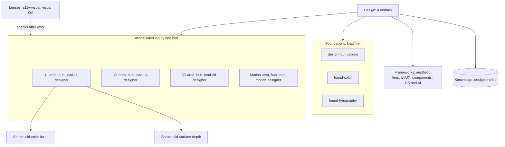
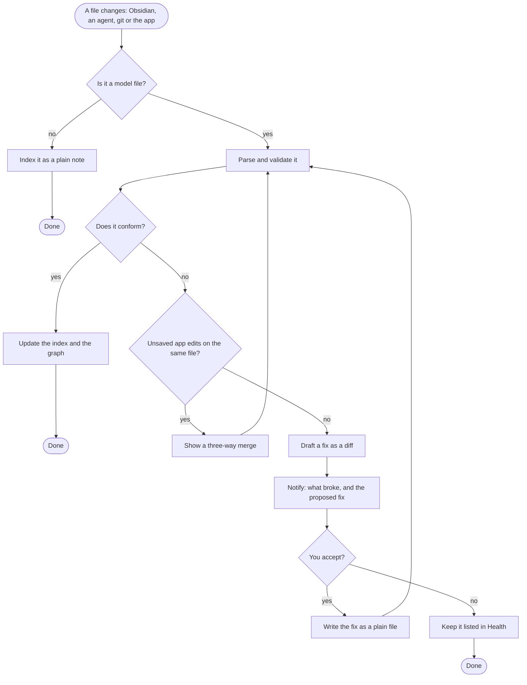

# Workspace model

**TL;DR:** The workspace model defines every kind of thing in a workspace: which file it lives in, which fields its frontmatter carries, and how it connects to other things. Everything else is built on it: the viewer, the graph, the health checks, the generator, the importer and the scores. It is written as a versioned spec plus machine-readable schemas (JSON Schema). Every file stays readable markdown that a person or any agent can open.

## Formats we read and write

- **`AGENTS.md`:** the shared instruction file most coding agents read.
- **`SKILL.md`:** the open Agent Skills format. A folder holds a `SKILL.md` whose frontmatter carries at least `name` and `description`.
- **MCP:** the Model Context Protocol, for tools agents call.
- **`llms.txt`:** a machine entry point listing what to read.
- **Markdown with YAML frontmatter and `[[wikilinks]]`:** the Obsidian dialect.
- **JSON manifests,** checked by JSON Schema.
- **Surface adapter files** (`CLAUDE.md`, `.cursor/rules`, `GEMINI.md` and the like). These are **generated** from the canonical files and never edited by hand.
- **Tools** in any language, each with a `tool.json` manifest.

Stage 0 checks each standard's current version. See the open decision on frontmatter placement in the [big picture](00-big-picture.md#open-decisions).

## Node types

| Type | What it is | Lives in | Key fields | In your workspace today |
|---|---|---|---|---|
| **Workspace** | The root | `AGENTS.md`, `llms.txt`, `workspace.json` | name, model version, layout | `AGENTS.md`, `workspace-manifest.json` |
| **Persona** | A side of life with its own accounts, apps and walls: work, personal or anything you add | `personas/<id>.md` | id, class, devices, surface instances, integrations, conduct rules | Context profiles, `devices.json`, the credential-scoping memory |
| **Domain** | A body of knowledge: design, engineering, game… | `domains/<id>/DOMAIN.md` | areas, foundations, frameworks, knowledge, triggers | Only a `domain:` tag (13 values) |
| **Area** | A part of a domain, led by one hub: UI, UX, 3D… | Declared in its domain file | id, hub | Implied by hubs |
| **Foundation** | Principles that load first | `SKILL.md`, `tier: foundation` | domain, triggers | 22 |
| **Hub** | The lead voice and entry point of one area | `SKILL.md`, `tier: hub` | domain, area, triggers, prerequisites | 45 |
| **Spoke** | A specialty skill | `SKILL.md`, `tier: spoke` | hub, governed_by | 188 |
| **Lens** | A cross-cutting check applied after work | `SKILL.md`, `tier: cross-cutting` | governs | 53 |
| **Framework** | An operating model. Highest doctrine. | `frameworks/NN-*.md` | id, domains, governs | 18 |
| **Knowledge entry** | Insight learned from real work, with freshness | `knowledge/<domain>/*.md` | triggers, as-of date, confidence, relations | 128 |
| **Memory entry** | A decision, fact, feedback or reference, outside any project | `memory/*.md` | type, relations, confidence | 46 |
| **Project** | A body of work with a baton | `projects/NN-name/` (README + `SESSION-STATE.md`) | status, persona, repo, triggers | 28 |
| **Session** | One session's record and handoff | `sessions/<id>.md`, session log | agent, surface, machine | Fragments + log |
| **Artifact** | A generated deliverable | `artifacts/` + registry | version, date, source | `05-artifacts/` + registry |
| **Reference** | A standard or spec others follow | `references/` | — | 27 markdown, 34 JSON |
| **Route** | A trigger phrase and what it loads | `routes.json`, knowledge hints | triggers → targets | 314 routes |
| **Tool** | A script or program | `tools/<name>/` + `tool.json` | language, entry, runtime, safety, implements | 47 Python scripts, no manifests |
| **Check** | A rule that passes or fails | Declared by a tool or the engine | applies to, severity, fix | Harness gates, close-out detectors |
| **Surface** | An agent app, with one or more installs | `surfaces.json` | id, instances (persona, path, account) | `surfaces.json`, `SURFACES.md` |
| **Integration** | A connection to an outside service by MCP, CLI or API | `integrations/*.json` | kind, persona, identity, capability | `capability-registry` |
| **Identity** | An account at a provider | Secure storage + policy | provider, account, persona | See [access](access/03-how-it-works.md) |
| **Adapter** | A generated surface file | Generated | source, target | `CLAUDE.md`, `.cursor/rules`, wrappers |
| **Plugin** | An extension | `plugins/<id>/plugin.json` | permissions, contributions | None |
| **Device** | A machine | `devices.json` | OS, personas | `devices.json` |

**Folders are not fixed.** A node's type comes from its frontmatter `type` (or `tier` for skills) plus a **layout map** that says where each type lives. Your numbered folders (`00-bootstrap` … `09-tools`) and a fresh generated layout are both valid. This is the "dialect" idea from `wsx consume`, made formal.

## Connections (edges)

| Edge | From → to | Hard or soft | Declared by |
|---|---|---|---|
| `belongs_to` | Any node → domain, area or project | Soft (grouping) | `domain`, `area`, `project` fields |
| `hub` | Spoke → hub | **Hard:** load the hub first | `hub` field |
| `prerequisite` | Skill → skill | **Hard** | `prerequisites` |
| `related` | Node → node | Soft: suggest, never auto-load | `related` |
| `governed_by` / `governs` | Skill ↔ lens | Lens runs **after** output | `governed_by`, `governs` |
| `defers_to` | Skill → skill or framework | Wins on conflict | `defers_to` |
| `builds_on`, `relates_to`, `supersedes` | Knowledge or memory → node | Typed relation | `relations` |
| `routes_to` | Route → node | Load hint | Route files |
| `implements` | Tool → check | — | `tool.json` |
| `applies_to` | Check → node type | — | Check declaration |
| `owns` | Persona → project, identity, surface instance, integration | Wall boundary | Persona file |
| `generated_from` | Adapter → source | Never hand-edit the target | Generator |
| `link` | Any → any | Untyped | `[[wikilink]]` in the body |

Every edge records its source, target, kind, whether it is hard, and where it was declared. That makes "why is this connected?" answerable in the app.

## Domains, areas and hubs

This is your domain idea, made concrete.



_Legend: solid arrows mean "contains." The dotted arrow means a lens checks the work afterwards. The cylinder is stored knowledge. Area names are examples. The real map is set after the first scan._

**Rules:**

1. **One primary domain.** Every foundation, hub, spoke and knowledge entry belongs to one domain. It may reference others.
2. **One hub per area,** and each hub leads one area.
3. **Light tags only.** A spoke names its hub. Its area and domain follow from that. Extra tags are allowed only if they agree, and a check enforces it.
4. **Lenses and frameworks attach at domain or workspace level.**
5. **Project skills belong to their project,** not to a domain area. Examples are `legion-project` and `omni-project`. On the graph they sit near the project.
6. **Load order doesn't change:** foundation → hub → spoke, with lenses after the work.

**What this would likely clear up** (the scan decides; nothing is pre-judged):

- the 26 design hubs settling into a smaller set of areas
- hubs without spokes becoming areas in waiting, or spokes
- overlaps that become visible once they share an area

## File contract: examples

**A domain** (`domains/design/DOMAIN.md`):

```yaml
---
type: domain
id: design
name: Design
summary: Visual, interaction and system design for screens and brands.
areas:
  - { id: ui, hub: lead-ui-designer }
  - { id: ux, hub: lead-ux-designer }
  - { id: 3d, hub: lead-3d-designer }
  - { id: motion, hub: lead-motion-designer }
foundations: [design-foundations, found-color, found-typography, found-composition, found-hierarchy, found-perception]
frameworks: [01-aesthetic-lens, 02-ui-ux-operational, 09-component-and-pattern, 18-design-systems-ai]
knowledge: knowledge/design/
triggers: [design, visual design, ui, ux]
model_version: "3.0"
---
```

The body below the frontmatter says, in plain words, what the domain covers, what it doesn't, and how its areas relate.

**A hub** (`skills/lead-ui-designer/SKILL.md`), with today's fields plus `area`:

```yaml
---
name: lead-ui-designer
description: Lead UI designer lens for screens, components and visual hierarchy…
tier: hub
domain: design
area: ui
triggers: [ui design, interface, screen design]
prerequisites: [design-foundations]
governed_by: [a11y-visual, visual-qa-ui-design]
spec_version: "3.0"
---
```

**A tool** (`tools/validate-links/tool.json`):

```json
{
  "id": "validate-links",
  "language": "python",
  "entry": "09-tools/validate-links.py",
  "runtime": "python>=3.11",
  "safety": "read-only",
  "network": false,
  "implements": ["check:skill-edges-resolve"],
  "run": { "check": [] },
  "output": "text-report"
}
```

**A persona** (`personas/work.md`):

```yaml
---
type: persona
id: work
class: employer
conduct: branch-pr-review        # no self-merge, no push to the default branch
devices: [work-mbp]
surfaces: [claude-desktop@work, cursor]
integrations: [github-work, jira-work]
---
```

## Versioning and migration

- **One model version for the workspace,** in `workspace.json`. Each node type's schema has its own version.
- **Today's skill frontmatter spec is v2.x.** Model 3.0 adds `type`, `area`, domain files, persona files and tool manifests.
- **Migrations are scripts.** They show a diff first, apply only on approval, and git can undo them.

## Outside edits and conformance

Obsidian, agents and git can all change files while the app runs. The app watches, checks and proposes. It never rewrites silently.



_Legend: rounded boxes start or end the flow. Diamonds are questions. Rectangles are steps._

**Coexisting with Obsidian plugins that also write.** Your vault runs Linter, Templater and others. The app notices when it and another writer keep changing the same file back and forth. It stops and asks, instead of fighting.

## Checks the model enables

Most of these exist today as `09-tools` scripts. The model gives each one a stable name, a target node type and a fix.

| Family | Examples |
|---|---|
| Structure | Frontmatter matches the schema. `name` matches the folder. Required fields are present. |
| Links | Wikilinks and edges resolve to tracked files. No dangling links. |
| Reachability | Every hub and foundation can be reached by some route. Well-formed isn't the same as reachable. |
| Load chains | Acyclic, foundation-first, hard edges kept to 0–2 per skill |
| Doctrine | `defers_to` and `governed_by` point at real lenses and frameworks |
| Freshness | Stale dates and aging claims in knowledge and memory |
| Token budgets | Session floor and worst-case load stay under budget |
| Walls | No employer content in personal areas, and no employer data leaving its devices |
| Secrets | No tokens or keys in any file |
| Generated files | Adapters and wrappers aren't hand-edited |
