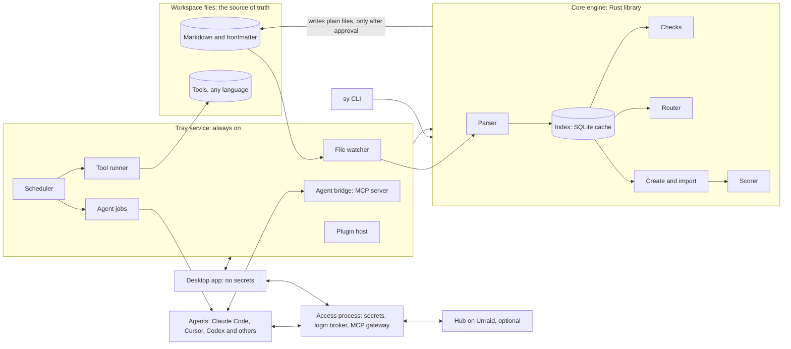

# Architecture

**TL;DR:** There are four running parts and one shared engine.

- **The core engine** is a Rust library that understands the workspace model. It reads files, checks them, routes requests, creates and imports workspaces, and scores the results.
- **The tray service** runs all the time. It watches files, runs tools and schedules, and serves agents.
- **A separate, small access process** holds every secret. It is kept apart so a bug in a tool or plugin can't reach a login.
- **The desktop app** is where you see and manage everything. It holds no secrets.
- **The `sy` command-line tool** gives scripts, CI and agents the same engine.

Files stay the source of truth throughout. The index the engine builds is a cache.

## The parts



_Legend: cylinders are stored data. Rectangles are running parts. Boxes around groups mark one program or one layer. Arrows show calls or data flow, and two-headed arrows go both ways._

## 1. Core engine (`sy-core`)

A Rust library with no user interface and no secrets. Every other part uses it, so the app, the CLI and agents always get the same answers.

| Component | Job |
|---|---|
| **Parser** | Reads markdown, frontmatter, wikilinks, JSON manifests and tool manifests into typed nodes and edges, using the layout map for this workspace's dialect |
| **Index** | SQLite with full-text search: nodes, edges, check results, issues, runs, scorecards. A cache in the app's data folder, never in the workspace. Rebuilt from files at any time. |
| **Checks** | Runs the model's built-in checks, and collects results from workspace tools |
| **Router** | Turns a request into an ordered load set (foundations first), suggestions and after-work lenses, matching `skill-loadset.py` exactly |
| **Create and import** | The generator and importer pipelines. See [Create and import](04-generator-and-importer.md). |
| **Scorer** | Produces scorecards. See [Measurement](05-measurement.md). |
| **Writer** | The only path for changing files. It writes atomically, keeps formatting, and works through proposals with diffs. |

## 2. Tray service (`sy-service`)

Runs as you from login: a LaunchAgent on Mac, a logon task on Windows. It never runs as an administrator.

| Component | Job |
|---|---|
| **File watcher** | Notices every change from any editor and feeds the parser. This drives the conformance flow in the [workspace model](01-workspace-model.md#outside-edits-and-conformance). |
| **Scheduler** | Nightly rebuilds, health checks, optimize runs and agent jobs you have scheduled |
| **Tool runner** | Runs workspace tools from their `tool.json`: Python, Rust binaries, Node, shell. It sets the working folder, a minimal environment, timeouts and a network on/off flag, then turns the output into check results. |
| **Agent bridge** | An MCP server that gives agents the workspace: load context, route, read, search, run checks, **propose** changes. It grows from `workspace_mcp.py` and keeps its guards (vault-only, no symlink escapes, no generated files, no wall files, secret scan). |
| **Agent jobs** | Hands judgment work to a connected agent. Details below. |
| **Plugin host** | Loads plugins and enforces the permissions they declare |
| **Local API** | How the app and CLI talk to the service: a socket on Mac, a named pipe on Windows, with caller checks |
| **Notifications** | Sends health, conformance and job events to the app |

## 3. Access process (`sy-access`)

This is the Personas & access module: the login broker, the MCP gateway, secure storage and walls. Its full design is in [access/01-systems](access/01-systems.md).

It runs as a **separate process** from the tray service for one reason: the service runs your tools, plugins and agent jobs, and those are the parts most likely to have bugs or be misled. Keeping secrets in their own small process means none of those can read a token.

## 4. Desktop app

Built with Tauri 2: a Rust shell around a React and TypeScript interface. It shows the [modules](03-app-experience.md) and talks to the service and the access process through their local APIs.

- **It holds no secrets** and can't read them.
- **The web view loads no remote content.** It accepts only the commands it is allowed.
- **Several workspaces** can be open, each tied to one or more personas. An employer workspace only opens on devices its persona allows.

## 5. The `sy` command line

The same engine, for scripts, CI and agents that prefer a shell:

```text
sy check [--fix]            run every check, list issues, optionally apply safe fixes
sy route "<request>"        ordered load set, suggestions, lenses, token cost
sy index                    rebuild the index from files
sy import <path>            start an import into a sandbox
sy create --profile <file>  generate a workspace
sy score <source> <output>  produce a scorecard
sy tool run <id>            run a workspace tool from its manifest
```

## 6. Agent jobs

An agent job is judgment work handed to an agent, with clear limits.

| Part of a job | What it holds |
|---|---|
| **Goal** | Plain instructions, such as "scan this workspace and report issues in this format" |
| **Inputs** | Which files or nodes it may read |
| **Tools** | Which bridge tools it may call. Read-only by default. |
| **Where** | A sandbox copy, or the live workspace through **proposals only** |
| **Output** | A fixed schema: findings, proposals, a draft file |
| **Budget** | Time and token limits |
| **Agent** | Whichever you connect: Claude Code (headless), the Claude Agent SDK, Codex CLI, Gemini CLI, or any MCP-capable client. It runs on that agent's own account. |

**First job types:** deep scan (import), optimize with judgment, draft a skill, reconcile overlapping skills, explain an issue.

**Results always come back as proposals** in the app. You accept, edit or reject them. Accepted proposals go through the same writer and checks as your own edits.

## 7. Plugins

| Contributes | Example |
|---|---|
| Views | A custom dashboard panel |
| Checks | A team's own naming rule |
| Importers | Bring in a Notion export or a Cursor rules repo |
| Adapters | Emit files for a new agent app |
| Integrations | A tracker or design tool the core doesn't cover |

**Runtime (recommended):**

- Logic plugins run as MCP servers in their own process, in any language.
- UI plugins run as sandboxed web panels.
- Each plugin has a signed manifest listing its permissions, and you approve them.
- Plugins never touch secrets.
- An updated plugin stays off until you review its new permissions.

WebAssembly components are the alternative, decided in Stage 5.

## 8. Hub (optional)

The hub from the access module. It passes encrypted policy and device lists between devices on your Tailscale network. **Workspace files sync through git as they do today.** The hub only carries what git shouldn't: device enrollment, access policy and health summaries.

## Technology

| Layer | Choice | Why |
|---|---|---|
| Engine and service | Rust | Fast parsing, safe concurrency, careful handling of secrets, one codebase for Mac and Windows |
| App shell | Tauri 2 | Tray, notifications, autostart, signed updates. Same as Fontface. |
| Interface | React 19 + TypeScript + Vite | Same as Fontface. Shares its component patterns. |
| Markdown editing | CodeMirror 6 | The editor Obsidian is built on, so raw markdown round-trips cleanly |
| 2D graph | Sigma.js with Graphology (WebGL) | Handles thousands of nodes smoothly |
| 3D graph | three.js through react-three-fiber, with a 3D force layout | Mature, fast, works on both OSes |
| Index | SQLite with FTS5 full-text search | One file, fast, rebuildable |
| File watching | `notify` crate | Native file events on each OS |
| git | git CLI first, `gitoxide` where speed matters | Matches what you run by hand |
| MCP | `rmcp`, the official Rust SDK, for both server (bridge) and client (gateway) | Tracks the spec |
| Schemas | JSON Schema, checked in Rust | The same schemas agents and other tools can read |
| Workspace tools | Run as they are (Python today) through `tool.json` | Nothing is rewritten just to fit |
| Access | As specified in [access/01-systems](access/01-systems.md#technology-choices) | — |

## Performance targets

- **Full index** of a 2,000-file workspace: under 3 seconds. Yours has about 1,300 markdown files.
- **Update after one file changes:** under 100 milliseconds.
- **Load-set answer:** under 50 milliseconds.
- **3D graph:** smooth at 2,000 nodes on Apple Silicon. Falls back to 2D on weak graphics or with reduced motion on.

## Repository layout (planned)

```text
switchyard/
  crates/
    sy-model/      node types, edges, schemas, layout maps
    sy-index/      parser and SQLite index
    sy-check/      built-in checks and tool-result intake
    sy-route/      router and load sets
    sy-create/     generator
    sy-import/     importer and scan orchestration
    sy-score/      scorecards
    sy-write/      safe writer and proposals
    sy-service/    tray service: watcher, scheduler, runner, bridge, jobs, plugins
    sy-access/     access process (from the access plan: store, providers, gateway)
    sy-hub/        optional hub
    sy/            CLI
  app/             Tauri 2 + React interface
  schemas/         JSON Schemas for every node type
  catalog/         surfaces.json, providers.json, dialects
  corpus/          synthetic and seeded test workspaces (your snapshot stays local)
  docs/            these plans, moved here in Stage 0
```
