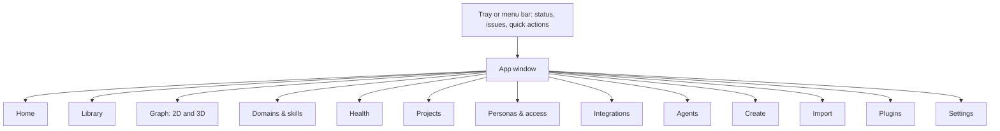
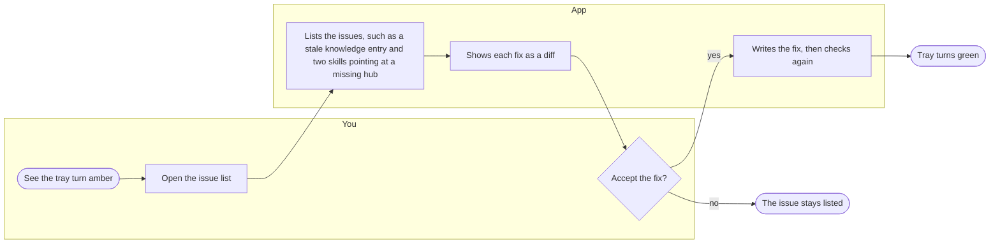
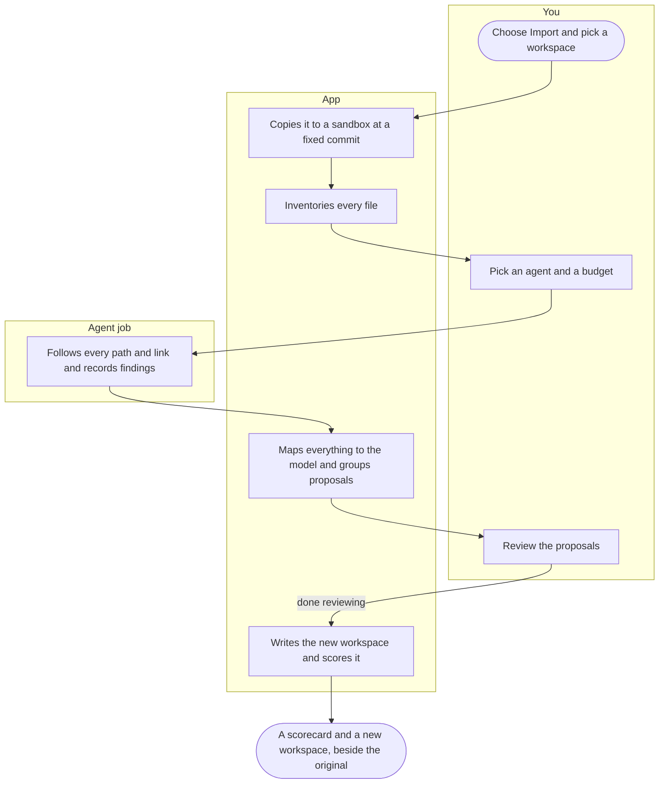

# App experience

**TL;DR:** The tray tells you when something needs attention. The window lets you see and manage the whole workspace: notes, the graph, domains and skills, health, projects, personas, integrations and agents. Creating and importing workspaces are guided flows. Anything an agent proposes comes back for your OK.

## Where things are

_Legend: each box is a place in the app. Arrows show where you can go from where._

## The tray

- **Icon states:**
  - **Green:** all good.
  - **Amber:** warnings.
  - **Red:** something critical, such as a wall breach attempt or a broken audit chain.
  - **Grey:** locked.
  - **Outline:** the service isn't running.
- **Menu:**
  - the workspace and persona in focus
  - issue count
  - the last session's next action
  - Run checks now
  - Lock
  - Open
- **Notifications carry one action each,** such as "Review fix," "Reconnect," "Open baton" or "Allow once."

## Screens

| Screen | What's on it |
|---|---|
| **Home** | The session card as a page: last session, pending items, every project's next action, health summary, recent agent jobs |
| **Library** | A file tree in your layout. A markdown editor with live preview (CodeMirror 6, as in Obsidian). Frontmatter shown as a form bound to the schema, with plain-text editing always available. Backlinks, outline, wikilink autocomplete. A conformance badge per file. |
| **Graph** | 2D and 3D views of the same model. Domains are regions and areas are clusters, with spokes around their hub. Filters by type, domain, persona, freshness and issues. Edge colours by kind (hard load, soft link, lens, typed relation). Click any node to open it. A list view shows the same data for anyone who can't or doesn't want to use the graph. |
| **Domains & skills** | Domains → areas → hubs → spokes, plus foundations, lenses and frameworks. A skill page shows the rendered document beside its **contract**: triggers, edges, what governs it, check status. A **load simulator**: type a request and see the ordered load set, suggestions, after-work lenses and token cost. |
| **Health** | One issue list by severity, each with the check that found it, the nodes affected and a fix. Buttons for doctor, harness, nightly rebuild, optimize, and optimize with an agent when one is connected. History and trends. Generator and importer scorecards. |
| **Projects** | A board of projects with their batons: focus, next action, open decisions, blocked on. Pending items. Session history. |
| **Personas & access** | Personas, accounts, app installs, walls and limits. Specified in [access/03-how-it-works](access/03-how-it-works.md#the-app). |
| **Integrations** | Per persona: each MCP server, CLI and API connection, its account and its status |
| **Agents** | Connected agents, the job queue, job history with inputs, outputs and cost, and each agent's permissions |
| **Create** | The guided generator. See journey 4. |
| **Import** | The guided importer. See journey 3. |
| **Plugins** | Installed plugins, their permissions, on/off, updates waiting for review |
| **Settings** | Workspaces, devices, schedules, notifications, appearance, updates |

## Key journeys

### 1. The daily check

_Legend: each box around a group is one actor's lane. Rounded boxes start or end the flow. The diamond is a decision._

### 2. An edit made in Obsidian

You change a skill in Obsidian and forget its hub. The app notices within a second, checks the file and notifies you: "lead-foo is missing its hub. Add `hub: lead-ui-designer`?" You accept or ignore it. The full flow is in the [workspace model](01-workspace-model.md#outside-edits-and-conformance).

### 3. Importing your workspace

_Legend: lanes are You, the App and the Agent job. Nothing is written into the original workspace._

### 4. Creating a workspace

1. **Devices and apps:** what you use and where. The app detects installed agent apps.
2. **Personas:** work and personal by default, or your own. Choose how each is walled: by app or by separate installs.
3. **Domains and expertise:** what you work on, and how deep you are in each. Skills are written at that level, a key idea carried over from `wsx`.
4. **Integrations and accounts:** per persona.
5. **Preferences:** tone, plain language, ask or proceed.
6. **Lifecycle:** session cards, batons, schedules, automation level.
7. **Review:** the full plan as a list and a diff, then create, then score.

Without an agent, the steps use forms and templates. With one, the agent can interview you and write the skills.

### 5. "What will this request load?"

In Domains & skills, you type "dark-mode palette for this dashboard." The simulator shows:

1. `design-foundations`
2. `lead-ui-designer`
3. `uid-color-for-ui`

It also shows the suggestions (`ds-advisor`, `uid-surface-depth`), the lenses that run after the work, and the token cost. This is the worked example in your `AGENTS.md`, made visible.

## Design and accessibility

- **Visual system:** start from Fontface's (shadcn/ui on Base UI, Tailwind v4, Material Symbols Rounded, IBM Plex), so both apps feel related. Confirmed in Stage 2.
- **Keyboard first:** every action reachable without a mouse, with a command palette.
- **Screen readers:** every graph has a list equivalent with the same information.
- **Reduced motion:** the 3D graph falls back to 2D, and animations stop.
- **Light and dark themes,** contrast checked.
- **Plain language** in every label and message, the same rule your workspace follows.
