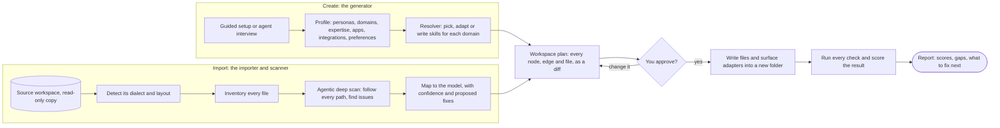

# Create and import

**TL;DR:** Two pipelines meet in the middle.

- **Create** (the generator) goes from your answers to a profile, then to a plan.
- **Import** goes from an existing workspace to an inventory, then a deep scan by an agent, then a plan.

Both produce the same thing: a **workspace plan**, which lists every node, connection and file as a reviewable diff. After you approve it, the same writer creates the files and the same checks and scorecard judge the result. Import never writes into the original.

## The two pipelines

_Legend: the cylinder is stored data. Rectangles are steps. The diamond is your decision. The rounded box is the end._

## The shared middle: the workspace plan

- **A JSON document** listing the intended nodes, edges, files and adapters, each with its source: your answers, an imported file, or an agent finding.
- **Diffable.** The app shows it as a list, as a graph and as a file diff.
- **Replayable.** The same plan always writes the same files, which makes runs repeatable and measurable.

## Create (the generator)

### Steps

| Step | What happens | From `wsx` |
|---|---|---|
| 1. Devices and apps | Detect installed agent apps, list devices | `scan.py`, interview movement M0 |
| 2. Personas | Work, personal or custom, and how each is walled | Movements M1 and M3, `gitscope.py` |
| 3. Domains and expertise | What you work on and how deep you go in each | Movement M2, the per-domain level idea |
| 4. Integrations | Services and accounts per persona | New |
| 5. Preferences | Tone, plain language, ask or proceed | Movement M4 |
| 6. Lifecycle | Session card, batons, schedules, automation level | Movement M5 |
| 7. Resolve | For each domain: pull an existing skill, adapt one, or write one new. Then reconcile overlaps. | `resolver.py`, `registry.py` |
| 8. Plan, review, write, score | The shared middle | `scaffold.py`, `adapters.py`, `bridges.py`, `moc.py` |

**Without an agent,** steps 1–6 are forms, and step 7 picks from a template library. **With an agent,** steps 1–6 can be an interview, and step 7 can write skills at your level for each domain.

### Patterns from your workspace that every generated workspace gets

These are the **refinements** you asked to carry over. They are general patterns only, never your personal or employer content.

- **Session card on start,** with the baton (live handoff) per project and session fragments folded into a bounded log.
- **Layer 0 routing:** trigger phrases → load chains, foundations first, with lenses after the work.
- **Close-out and self-improve:** checks after producing work, and new checks minted from repeated findings.
- **Domain rigor:** the five-layer stack for any domain (operating model, commands, measurement, load chain, multiple voices).
- **The QA operating model** as a gate before delivery.
- **Persona walls and conduct rules,** for example branch → PR → review for employer repos.
- **Harness with token budgets,** so the workspace never costs more than it gives.
- **Knowledge with freshness dates and memory with typed relations.**
- **Registries you query rather than read whole.**
- **The plain-language rule.**
- **Plan-ahead for multi-step work.**
- **Archive, don't delete,** with provenance.

### Emitting to agent apps

One canonical workspace, with a generated adapter for each app: Claude Code, Cursor, Codex and `AGENTS.md`, Gemini, Windsurf, an MCP runtime, and a paste pack for chat-only tools. Adapters are always regenerated, never edited. This is `wsx`'s degradation ladder, kept: native tools first, then the CLI, then a paste pack.

## Import (the importer and scanner)

### Safety first

- **The source is never written.** Import copies it to a sandbox folder at a fixed git commit, or uses a git worktree.
- **Imported content is untrusted.** A note can contain text that tries to steer an agent. The scanning agent:
  - runs on the copy
  - has read-only tools and no network beyond its model
  - can only report findings in a fixed format
- **Your workspace's snapshot stays on your Mac.** It is never pushed or shared.

### Stages

| Stage | Who | What happens | Output |
|---|---|---|---|
| A. Discover | Engine | Find the root, detect the dialect (numbered folders, a plain Obsidian vault, a Cursor rules repo, an old `wsx` layout), read the git state | Layout map |
| B. Inventory | Engine | Parse every file: frontmatter, links, headings, code blocks, manifests. Classify what the rules can. List everything else as unclassified. | Inventory with candidate nodes and edges |
| C. Deep scan | **Agent** | Start at the entry points (`AGENTS.md`, `llms.txt`, routes, MOCs). Follow every edge and link. Read bodies. Judge the whole structure. | Findings in a fixed schema |
| D. Map | Engine + agent findings | Propose the model: node types, domains and areas, edges, fixes. Each comes with confidence and evidence. | Proposals |
| E. Review | You | Accept, edit or reject. Bulk-accept high-confidence mechanical fixes. | An approved plan |
| F. Write | Engine | Create the new workspace in a new folder | New workspace |
| G. Verify and score | Engine | Every check plus the scorecard against the source | Scorecard |
| H. Fix back (optional) | You | Send chosen fixes to the original workspace through its own process, for yours a branch and your review | Changes upstream |

### What the deep scan looks for

The scan considers the whole graph, not one file at a time:

- **Orphans:** nodes nothing points to.
- **Unreachable hubs and foundations:** no route reaches them.
- **Overlapping or duplicate skills.**
- **Hubs without spokes,** and skills in the wrong tier.
- **Missing or inconsistent domain and area tags.**
- **Project content mixed in with domain skills.**
- **Contradictions between doctrine files,** such as a framework against a skill or one memory entry against another.
- **Stale facts:** old dates and superseded decisions still live.
- **Broken load chains, and routing gaps:** common requests with no route.
- **Token hotspots:** files read too often or too large.
- **Wall leaks:** employer text in personal areas.
- **Tools without manifests,** and checks with no owner.

**Every finding** carries:

- an ID and a type
- the nodes involved
- **quotes as evidence, with file and line**
- a severity and a confidence
- a proposed fix

### Making sure it really follows every path

- **A coverage ledger.** The scan keeps a record of every node and edge it visits. It isn't finished until it has visited 100% of the inventory, or recorded why it skipped something.
- **Split, then join.** Large workspaces are scanned one domain at a time in parallel. A final cross-domain pass then looks at the whole graph, because many issues only show up between domains.
- **Repeatable.** The same snapshot and the same scan version should produce the same findings. Differences between runs are measured. See [Measurement](05-measurement.md).

### Less agent over time

When the agent finds the same kind of issue more than once, that issue becomes a **deterministic check** in the engine. The scorecard tracks **agent dependence**: the share of findings caught by plain rules. It should rise with each release, so later imports need the agent less.

### How your workspace maps (first draft)

| Your workspace | Model |
|---|---|
| `03-skills/*` | Skills by tier, with domain and area added |
| `01-frameworks/` | Frameworks |
| `08-knowledge/<domain>/` | Knowledge entries in that domain |
| `06-context/memory/` | Memory entries |
| `07-projects/` | Projects with their batons |
| `06-context/sessions/`, `session-log.md` | Sessions |
| `02-shared-references/*.json` | Routes, catalogs and references |
| `09-tools/` | Tools (each needs a `tool.json`) and the checks they implement |
| `00-bootstrap/` | Workspace setup, doctor and adapter sources |
| Root `_*.md` hubs (MOCs) | Views the app regenerates |
| `.claude/`, `.cursor/`, `.windsurf/` | Generated adapters |
| `05-artifacts/` | Artifacts |
| `_archive/` | Archive, read-only |

## Where `wsx` pieces go

| `wsx` module | Becomes |
|---|---|
| `interview.py` | The Create wizard and the agent interview |
| `profile` (`profile.yaml`) | The profile schema |
| `resolver.py`, `registry.py` | The resolver |
| `scaffold.py`, `adapters.py`, `bridges.py`, `dest.py` | The writer and the surface adapters |
| `examine.py`, `diagnose.py`, `consume.py` | Import stages A and B |
| `restructure.py` | Model migrations |
| `ingest.py` | Consent-gated intake of outside content |
| `reach.py`, `health.py` | Checks |
| `loadset.py`, `dispatch.py` | The router and close-out checks |
| `gitscope.py` | Personas & access |
| `moc.py` | Generated views |
| `mcp_template.py` | The agent bridge, via `workspace_mcp.py` |

`wsx` keeps working as it is until the app reaches parity. Its test runs become part of the measurement corpus.
