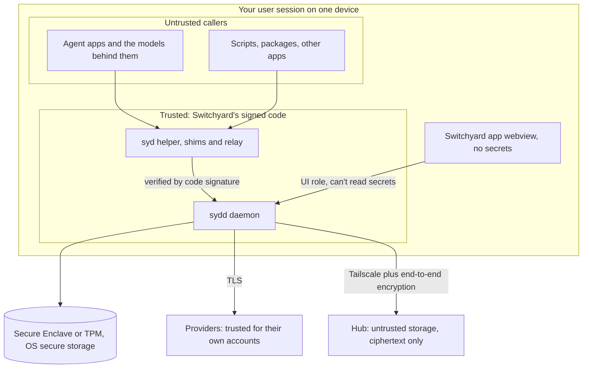

# Security

**TL;DR:** Switchyard holds every login you have, so it is designed as if someone is always trying to steal them. It makes five commitments:

1. Secrets never leave the device that earned them.
2. The rules decide who gets a credential, never the caller.
3. Every hand-out is checked, kept to the minimum and logged.
4. Anything that syncs is encrypted, so the server learns nothing.
5. What Switchyard can't protect is written down here, not hidden.

This applies the same way while it's only for you and if it ever becomes a product.

## What we protect

| Asset | Lives in | Why it matters |
|---|---|---|
| Provider credentials: access tokens, refresh tokens, SSH keys | Each device's secure storage | Direct access to your code, trackers and employer systems |
| Device keys | Secure Enclave or TPM | Prove which device is speaking. Can't be exported. |
| Fleet key | Each enrolled device's secure storage | Decrypts synced rules |
| Recovery key | Vaultwarden and a printed copy | Can rebuild the fleet |
| Policy | Each device, plus the hub encrypted | Its integrity decides who gets which credential |
| Audit log | Each device | Evidence of what happened. Contains repo and org names. |
| Your vault | Vaultwarden on Unraid | Every other password you own |

## Who we protect against

| ID | Threat | Likelihood | Example |
|---|---|---|---|
| T1 | A prompt-injected agent running as you | **High** | A README or issue tells the agent to push code to a new remote or read a token |
| T2 | Malware or a bad package running as you | Medium | A package install script calls the daemon's socket or reads stored credentials |
| T3 | Lost or stolen device | Medium | A laptop left in a taxi, asleep or powered off |
| T4 | Network attacker | Low to medium | Café Wi-Fi intercepting sync or vault traffic |
| T5 | Compromised Unraid server or hub | Low to medium | An attacker replays old rules or slips in a rogue device |
| T6 | Compromised Switchyard update or dependency | Low, high impact | A malicious crate or a hijacked release |
| T7 | Your own mistakes | **High** | Signing into the wrong account, committing under the wrong email, pasting a token in the wrong place |
| T8 | Side-channel leaks | Medium | Tokens in logs, crash dumps, shell history, process listings, screenshots |
| T9 | A removed device keeps access | Medium | An old laptop still holding working tokens |
| T10 | The vendor (product case) | — | We must be unable to read user data, even if breached or compelled |

T1 and T7 are the most likely. They drive most of the design.

## Trust boundaries

Callers are never trusted. Switchyard's own helper programs are trusted code, but the requests they carry come from untrusted callers. The daemon makes every decision itself.

## Controls

### 1. Storage: secrets at rest

**Mac:**

- **Keychain items in Switchyard's access group.** Only programs signed with Switchyard's developer team ID can read them.
- **Marked "this device only."** They never sync to iCloud Keychain and never restore to another Mac from a backup.
- **Two vault keys, one per class, wrapped by a Secure Enclave key.**
  - **Personal class key:** unlocks with your login session.
  - **Employer class key:** needs Touch ID or your password. It stays in memory for the presence interval (8 hours by default), then it is wiped.

**Windows:**

- **Credential Manager is weaker.** Any program running as you can read its entries. So Switchyard doesn't rely on it.
- **Encrypted vault file instead.** Switchyard encrypts its secrets with its own vault keys and stores them in that file.
- **Vault keys protected by a non-exportable TPM key.**
- **Employer class key unlocks through Windows Hello.** This uses a Hello signature, a technique password-manager plugins already use. Phase 0 tests it.
- **Data stays local.** It lives in `%LOCALAPPDATA%`, never in a roaming profile.

**Both:**

- **No secret is ever written to a plain file.** Policy, state and logs hold none. CI scans written files for token patterns.
- **Memory hygiene:**
  - Secrets sit in locked memory pages that the OS won't swap to disk.
  - They are wiped when dropped.
  - They are held in types that can't be printed or logged.
- **No crash dumps.** Core dumps are off for the daemon, and it is excluded from Windows error reporting dumps.
- **Disk encryption required.** FileVault or BitLocker must be on. Watch raises a critical alert if it's off.

### 2. Release: who gets a secret, and when

- **The rule decides, never the caller.** Callers send context (a URL and a folder). They can't name an identity. The one exception, `syd as`, always needs a presence check, is always logged, and can't cross a wall.
- **Walls are absolute:**
  - Personal identities are never released in employer context.
  - Employer identities never exist on devices not classed for them.
  - A repo with **any** employer remote counts as employer for **every** remote. This blocks the "add a personal remote and push" exfiltration path.
- **Caller checks.** For every connection, the daemon asks the OS for the caller's process, finds its program file and verifies its code signature.
  - Only Switchyard's own signed helpers may request credentials.
  - A script that talks to the socket directly is refused and reported.
  - This doesn't stop a script from running `git` itself. Walls, presence checks and thresholds cover that case.
- **Surface awareness.** The daemon walks the caller's parent processes to see which app started it: Claude Code, Cursor, Terminal and so on.
  - Rules can limit identities by surface, for example "Cursor may use personal identities only."
  - The log records the surface for every decision.
- **Presence checks** (Touch ID, Windows Hello or password) are required for:
  - the first use of an employer identity in each interval
  - every `syd as` override
  - adding or removing identities, devices or rules
  - accepting a policy change that came from another device
- **Least privilege.**
  - Tokens are per device and per identity, never shared.
  - Each one gets the smallest permissions and shortest lifetime the provider supports.
  - Tokens broader than an identity's limits are refused at sign-in.
- **Thresholds catch the unusual:**
  - a burst of requests (more than 30 a minute for one identity by default)
  - the first use from a new surface
  - repeated refusals

  Each triggers an alert. Hitting a hard cap blocks that identity for a short time and tells you.
- **The narrowest channel.**
  - git gets the token through the helper's output pipe, not the environment or a file.
  - `gh` gets it in its own process environment only.
  - Agents never get it. The gateway attaches it upstream.
- **MCP tool policy.** Each identity can allow or deny tools, run read-only, or "ask first" before writes. Switchyard can't clean the text that tracker items contain, and that text may itself carry injected instructions. It limits what an agent can **do** with that account.

### 3. Local channels

- **Socket and pipe:**
  - **Mac:** a Unix socket in a folder only you can open (mode 0700).
  - **Windows:** a named pipe that only your account can open, with remote clients rejected.
  - **Both:** the caller checks above apply to every connection.
- **Protocol:** versioned, strictly parsed, size-limited and fuzz-tested.
- **Optional local HTTP endpoint for MCP:** off by default.
  - When on, it listens on `127.0.0.1` only, on a random port.
  - It needs a per-app secret.
  - It checks the `Origin` and `Host` headers to block web pages from reaching it through DNS rebinding. The MCP spec requires this.
- **App to daemon:**
  - The UI role can't read secrets.
  - Tauri's capability list limits the webview to named commands.
  - A strict content security policy blocks remote content and code evaluation.

### 4. Sync and the hub

- **What syncs:** the policy, the signed device list, enrollment messages and optional health summaries.
- **What never syncs:** tokens, SSH keys, vault keys. The fleet key is the one key that travels, and only encrypted to each device's own key.
- **Encryption:**
  - Every payload is encrypted with the fleet key (XChaCha20-Poly1305).
  - It is signed by the sending device's key.
  - Receivers verify the signature against the signed device list.
- **No rollback.** Policy versions are numbered, and devices refuse anything older than what they have.
- **The hub is a mailbox.** It sees ciphertext, device IDs and timestamps.
  - It can delay or withhold updates. Devices alert when sync is stale.
  - It can't read or forge anything.
- **Transport:** Tailscale (WireGuard) plus HTTPS. The hub is never exposed to the internet.
- **Enrollment** needs admin approval **and** a matching safety phrase on both screens. That defeats a hub that tries to swap in its own key. Employer classes need a separate grant for each device.
- **Removal:**
  - It rotates the fleet key and sends a signed removal notice.
  - It starts the provider revocation checklist.

### 5. Vaultwarden

- **Not a runtime dependency.** If Unraid is down, git still works.
- **Switchyard never stores your master password or a `bw` session key.**
  - It uses the `bw` CLI only for actions you start and are present for: importing a credential, saving the recovery kit.
  - It locks the vault immediately afterwards.
- **Never `bw serve`.** Its local web API has no authentication. Any program on the machine could read the unlocked vault through it.
- **Employer secrets never go into Vaultwarden.**
- **Server hardening** is in [Vaultwarden](05-vaultwarden.md).

### 6. Logs and audit

- **The audit log records every decision:**
  - granted or refused
  - which program and surface asked
  - the target (host, owner, repo or service)
  - the identity
  - the rule that decided

  It never records a secret value.
- **Tamper-evident.** Each entry includes the hash of the one before it, so edits or deletions break the chain. A daily check verifies it. Signed checkpoints can sync to the hub.
- **Diagnostic logs are redacted twice:**
  - Secret types can't be printed.
  - A scrubber catches known token patterns such as `ghp_`, `gho_`, `github_pat_` and Linear and Atlassian key formats as a second net.
- **Crash reporting is off by default.** When on, reports are scrubbed and you review them before they are sent.
- **Employer details stay local.** Audit entries and health summaries for the employer class never go to the hub.

### 7. Updates and supply chain

- **Signed builds:**
  - Apple Developer ID with notarization.
  - Windows Authenticode or Trusted Signing.
- **Signed updates.** Tauri's updater checks each update against a separate key kept offline, not the code-signing key.
- **Signing is a security root.** Caller checks depend on signatures, so the signing credentials are protected: short-lived CI credentials where supported, never on a dev laptop in plain form.
- **Dependencies:**
  - few in the daemon
  - `cargo-deny` checks licenses, advisories and banned crates
  - `cargo-audit` runs in CI
  - the lockfile is pinned and updates are reviewed by hand
  - each release gets an SBOM (software bill of materials)
  - reproducible builds are the goal
- **CI:**
  - GitHub Actions with least-privilege tokens.
  - Actions pinned to exact commit hashes.
  - No long-lived secrets in the repo.
- **Release checklist** includes a security read of everything changed since the last release.

### 8. Mistake-proofing (T7)

- **Identity pinning** refuses a sign-in to the wrong account.
- **Commit identity** comes from the rules, and Watch flags commits by the wrong author.
- **The rule tester and validator** catch overlapping rules, unreachable identities and wall conflicts before you save.
- **No copy-token feature.**
- **Safe defaults:**
  - deny anything unmatched
  - HTTPS first
  - "ask first" for agent writes to employer trackers until you choose otherwise

## Threat to control map

| Threat | Main controls | Residual risk |
|---|---|---|
| T1 Injected agent | Walls, rule-decides, repo-wide classification, MCP tool policy, presence for overrides, thresholds, token never reaches the model, audit | It can still misuse the **right** identity in the **right** repo |
| T2 Malware as you | Caller checks, keychain access groups, encrypted vault on Windows, short-lived tokens, thresholds | Code injected into a trusted program can act as it |
| T3 Lost device | Disk encryption, device-only items, hardware keys, class locks, remote removal, revocation | An unlocked, awake device in hostile hands |
| T4 Network | Tailscale, TLS, end-to-end encryption, signatures | Metadata such as timing |
| T5 Hub | End-to-end encryption, signatures, no rollback, safety phrase, staleness alerts | Delayed or withheld updates |
| T6 Supply chain | Signing, offline update key, dependency checks, SBOM, pinned CI | A compromise upstream of review |
| T7 Mistakes | Pinning, commit scan, rule tester, walls, notifications | Rules that are wrong but valid |
| T8 Side channels | Unprintable secret types, redaction, no dumps, pipe delivery, scrubbers | Env of a running `gh` process, readable by same-user programs while it runs |
| T9 Removed device | Key rotation, per-device tokens, revocation checklist | Tokens that can't be revoked by API until you do it by hand |
| T10 Vendor | Zero-knowledge design, no telemetry by default, published security docs, external audit | Trust in signed updates |

## What Switchyard can't protect

1. **A program running as you that can inject code into allowed programs can act as them.** Hardened runtime on Mac and signature checks raise the bar. They don't remove the risk.
2. **A manipulated agent can still do harm with the right identity in the right repo**, such as pushing a bad commit to your own project. Switchyard limits the blast radius. It doesn't judge intent.
3. **Hosted surfaces** sign in on vendor servers, out of reach.
4. **Windows isolates apps less than macOS does.** The encrypted vault and Hello gating narrow the gap, but don't close it.
5. **Some tokens are long-lived** because the provider or employer gives no choice (`gh` imports, Linear API keys). They are watched and rotated, not eliminated.
6. **A token in a child process's environment** can be read by other programs running as you while that process runs. Short `gh` calls keep the window small.
7. **One maintainer, no second reviewer.** External review is required before any commercial release.

## Security testing plan

- **Threat model review** at the start of every phase. This document is updated with each review.
- **Policy engine property tests:** across random rules and contexts, a wall is never crossed and unmatched requests are always refused.
- **Fuzzing:** the IPC protocol, the policy parser and the MCP relay.
- **Leak tests:** run full flows with canary tokens, then search logs, state files, crash output and long-running process environments for them.
- **Platform checks:** keychain item attributes, pipe access lists, socket permissions, signing on every shipped binary.
- **Red-team scenarios,** scripted and run in CI where possible:

| ID | Scenario | Expected |
|---|---|---|
| S1 | Agent in a personal repo asks for the employer GitHub token through `syd as`, without presence | Refused, alert |
| S2 | Agent adds a personal remote to an employer repo and pushes | Refused by wall, critical alert |
| S3 | Script connects to the socket directly, posing as the git helper | Refused by caller check, alert |
| S4 | Script reads Switchyard's keychain items with `security` | OS denies or prompts |
| S5 | Hub serves an older policy | Refused as rollback, alert |
| S6 | Hub injects a rogue enrollment | No approval or phrase mismatch, so rejected |
| S7 | Removed device tries to sync | Refused, and it wipes on notice |
| S8 | Agent calls a denied MCP tool, then an "ask first" tool | Refused, then held until you answer |
| S9 | Canary token after all flows | Appears nowhere at rest |
| S10 | Web page posts to the local HTTP endpoint with a foreign origin | Rejected |
| S11 | Sign-in to the wrong account | Refused by pinning |
| S12 | Daemon killed mid-request | Helper fails closed, nothing partial on disk |

- **External code audit and penetration test** before any commercial release, then a bug bounty after launch.

## Employer considerations

- **Ask first.** Confirm with your employer's IT or security policy that a personal tool may hold employer credentials on the Work MBP. Do this before Phase 2 runs there.
- **Employer data stays on the Work MBP.** Employer identities, tokens, audit entries and repo names never go to Vaultwarden, the hub, the Windows PC or the Personal MBP.
- **Switchyard works inside employer controls,** never around them: SSO authorization, org app restrictions and token approval flows.
- **It complements the workspace's existing rule** that personal identity never appears on an employer commit. It doesn't replace that rule.
