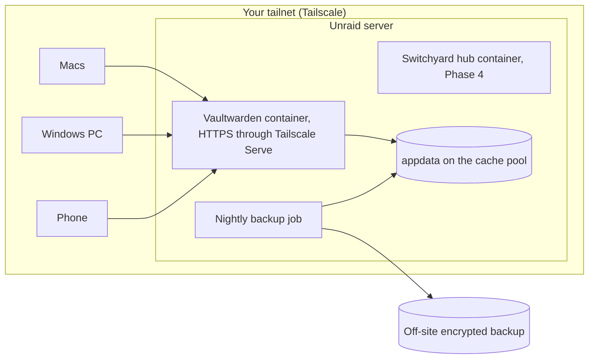

# Vaultwarden on Unraid

**TL;DR:** Vaultwarden is a sound replacement for 1Password for everyday passwords, passkeys, one-time codes and, through the Bitwarden desktop app, SSH keys. You lose three things:

- running commands with secrets injected (`op run`)
- per-folder command-line logins (shell plugins)
- Claude signing in to websites without seeing the password

Switchyard replaces the first two. Nothing replaces the third yet. Run Vaultwarden only on your Tailscale network, keep it updated, and test restoring from backup before you cancel 1Password.

## Its role in the system

- **Vaultwarden** is your password manager and holds the recovery kit.
- **Switchyard** routes credentials for development tools.

They meet in three places only:

1. **Setup-time import.** When you add an identity, Switchyard can read a stored token from Vaultwarden through the `bw` CLI while you are present, then lock the vault again.
2. **Recovery kit.** Switchyard's fleet recovery key is saved there as a secure note.
3. **Health checks.** Watch checks the server's reachability, version and certificate, and later its backup age.

Switchyard never needs Vaultwarden to run. Employer secrets never go into it.

## Feature parity for your use

Vaultwarden is a community-built server that speaks the Bitwarden protocol. You use the official Bitwarden apps with it.

| Need | 1Password | Vaultwarden + Bitwarden apps |
|---|---|---|
| Passwords, autofill in browsers and on phones | Yes | Yes |
| Passkeys stored in the vault | Yes | Yes |
| One-time codes (TOTP) | Yes | Yes. Bitwarden charges for this on its own cloud; Vaultwarden includes it. |
| Vault health reports (reused, weak, exposed passwords) | Yes (Watchtower) | Yes (Bitwarden's reports, included) |
| Attachments, secure send | Yes | Yes |
| Sharing with family | Yes | Yes, through organizations, at no cost |
| Emergency access | Yes | Yes, needs email (SMTP) set up for invitations |
| SSH agent with keys in the vault | Yes | Partly. Bitwarden desktop has one. Older Vaultwarden versions need two experimental flags. With several keys, pick one key per host. |
| Command-line access | Yes, `op` | Yes, `bw`, against your own server |
| Run commands with secrets injected | Yes, `op run` and secret references | No. Bitwarden's Secrets Manager isn't in Vaultwarden. **Switchyard's `syd run` replaces this.** |
| Per-folder CLI logins | Yes, shell plugins | No. **Switchyard's routing replaces this.** |
| Claude signs in without seeing the password | Yes, wired up today | No equivalent. Bitwarden's MCP server hands secrets to the agent, which is weaker. |
| Travel mode (hide vaults at borders) | Yes | No |
| Who patches the server | 1Password | You |
| Works when the server is down | Yes | Partly: cached vault readable, no sync |
| Independent security audits of the server | Yes | Bitwarden's server is audited. Vaultwarden is a separate codebase and isn't covered by those audits. |
| Cost | Subscription | Free |

## Deployment on Unraid

### Steps

1. **Prerequisites.**
   - Unraid 7.
   - The official Tailscale plugin.
   - MagicDNS and HTTPS certificates turned on in the Tailscale admin console.
2. **Container.**
   - Install `vaultwarden/server` from Community Apps.
   - **Pin a version tag**, 1.36.0 or later, rather than `latest`. Upgrades then happen when you choose.
   - Keep appdata at `/mnt/user/appdata/vaultwarden` on the SSD cache pool.
3. **HTTPS.**
   - Use Unraid 7's per-container Tailscale option with Serve. That gives the vault its own name, such as `https://vault.<tailnet>.ts.net`.
   - Bitwarden apps need HTTPS for their encryption to work in the browser.
   - Forum reports describe a port conflict after reboots when `tailscale serve` runs on the Unraid host itself. The per-container option avoids it.
   - Machine names appear in public certificate logs, so pick a plain name.
4. **Settings** (environment variables):
   - `DOMAIN=https://vault.<tailnet>.ts.net`
   - `SIGNUPS_ALLOWED=false`, set after you create your own account
   - `INVITATIONS_ALLOWED=false` unless you are sharing with family
   - `SHOW_PASSWORD_HINT=false`
   - `ADMIN_TOKEN` as an Argon2 hash, never plain text. Better still, leave it unset when you aren't administering: an unset token turns the admin page off.
   - `LOG_LEVEL=warn`
   - SMTP only if you want emergency access invitations. **Don't use email as a second factor.** A 2026 flaw let attackers bypass login rate limits when email two-factor was on.
5. **Your account.**
   - A long master passphrase: six or more random words.
   - Argon2id as the key derivation setting, chosen in account settings.
   - Two-factor: a security key or passkey (WebAuthn), with an authenticator app as backup.
   - Store the recovery code offline.
6. **Network access.**
   - Tailscale access rules should let only your own devices reach the vault on port 443.
   - **No port forwarding, no public tunnel.**
7. **Updates.**
   - Apply security releases within 48 hours.
   - Read the changelog and snapshot appdata before each upgrade.
   - Until Watch exists, turn on GitHub release notifications for the Vaultwarden repo.
   - 2025–26 fixes included an admin-panel code-execution bug (1.33.0), a two-factor bypass (1.35.0), refresh tokens that survived a password change (1.35.5) and a collection access bypass (1.36.0).
8. **Backups.**
   - **What:** `db.sqlite3` (copied with SQLite's online backup, never a raw copy while running), `attachments/`, `sends/`, `rsa_key*` and `config.json`.
   - **When:** nightly through the User Scripts plugin, keeping 30 days.
   - **Off-site:** encrypt and copy off the server, for example with `restic` to a cloud bucket or another machine.
   - **Second copy:** once a month, an encrypted JSON export from a Bitwarden app, stored away from the server.
   - **Prove it:** restore into a throwaway container every quarter.
   - **Alerts:** Unraid's own notifications report backup failures. Once the hub exists in Phase 4, the job also posts a small status note that Watch reads.
9. **Apps.**
   - Install Bitwarden on each Mac, the Windows PC, your phone and your browsers.
   - Choose "self-hosted" and enter the vault address.
   - Phones need Tailscale on to sync. The cached vault works offline.
10. **SSH keys.**
    - Turn on the SSH agent in Bitwarden desktop and keep "ask for authorization" on.
    - **Windows:** first set the "OpenSSH Authentication Agent" service to Disabled. Both use the same named pipe.
    - If your Vaultwarden version still needs them, set `EXPERIMENTAL_CLIENT_FEATURE_FLAGS=ssh-key-vault-item,ssh-agent`.
    - Keep personal keys only. The employer key stays on the Work MBP.

## Migrating from 1Password

| When | Step |
|---|---|
| Week 0 | Deploy, set up backups, test one restore |
| Week 1 | Export from 1Password in its 1PUX format and import into Bitwarden, which reads that format. Spot-check 20 items, one-time codes and attachments. |
| Week 1 | **Passkeys** may not come across in the export. Plan to re-register them on each site, or use the newer credential-exchange transfer if both apps support it on your devices by then. |
| Week 1 | **SSH keys:** generate a new key per identity rather than moving old ones. Register them with GitHub. Retire the old keys. |
| Weeks 1–4 | Run both. Use Bitwarden first and keep a list of gaps. |
| Week 4 | **Cutover checklist:** autofill works on every device, phone sync over Tailscale is reliable, the SSH agent works with git on Mac and Windows, a restore has been tested, nothing is missing |
| Week 5 | Remove 1Password hooks: the `IdentityAgent` line for 1Password in `~/.ssh/config`, shell plugin aliases, `op` calls in scripts. Decide about Claude's 1Password sign-in link. |
| Week 5 | Keep one final encrypted 1Password export offline, then cancel |

**The real trade-off is Claude's website sign-in.** Today Claude can sign in to sites through 1Password without seeing passwords. After the switch you'd sign in yourself when Claude asks. If that matters, a small 1Password plan kept only for that link is an option. Decide in week 4.

## Risks

- **You are the administrator.** Updates, backups and uptime are yours.
- **Server outage:** phones and laptops keep their cached vault, but nothing syncs.
- **Audit gap:** Vaultwarden isn't covered by Bitwarden's audits.
- **Client drift:** Bitwarden apps sometimes need features Vaultwarden hasn't built yet. Hold back app updates when release notes warn of this.
- **Single box:** if Unraid dies, the off-site backup and the monthly export are your way back. That is why the restore test matters.

## What Switchyard watches

- **Reachability:** the vault answers over Tailscale.
- **Version:** read from the server and compared with the latest Vaultwarden release. Critical if a security release is missing.
- **Certificate expiry:** Tailscale certificates renew on their own, so an expiring one means renewal has failed.
- **Backup age:** from the hub status note in Phase 4. Warning after 36 hours.
