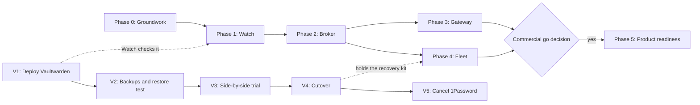

# Phases (Personas & access)

**TL;DR:** The plan has five phases plus a separate Vaultwarden track. Each phase ships something you use every day, on Mac and Windows, before the next one starts. The order is:

1. Watch problems.
2. Fix the account routing.
3. Route agent tracker access.
4. Keep devices in step.

Product work (phase 5) only starts if you decide to sell it. Nothing earlier has to be redone for it.

## Order of work

Phases 3 and 4 can run in either order after Phase 2. Phase 3 comes first because routing agents to the right Linear and Jira account is the daily pain. Phase 4 matters once the third device, the Windows PC, makes setup by hand tiresome.

## Effort

Sizes are in **focused weeks**: full-time-equivalent weeks of building with agent help. Calendar time depends on how much time you give it. Every phase includes about 30% for Windows parity, because Windows is new to your fleet.

| Phase | Size |
|---|---|
| 0 Groundwork | 1–2 focused weeks |
| 1 Watch | 2–3 |
| 2 Broker | 4–6 |
| 3 Gateway | 4–6 |
| 4 Fleet | 3–4 |
| 5 Product readiness | 8–12 or more, only after a go decision |
| Vaultwarden track | A few evenings, then a 30-day trial |

## Done means (every phase)

- It works on **macOS and Windows**: Work MBP, Personal MBP and the Windows PC.
- [Security](04-security.md) has been re-reviewed and updated. The phase's red-team scenarios are scripted and pass.
- `syd uninstall` returns the machine to its state before install.
- Docs match the build.
- It ships as a signed release from CI.

---

## Phase 0: Groundwork

**Goal:** lock decisions, set up the repo and pipelines, and test the riskiest unknowns before building on them.

**Work:**

- Create `~/Projects/switchyard` and the private repo `snds/switchyard`. Move these plan docs into `docs/`. This vault folder then keeps the baton and pointers, the same pattern as Fontface.
- Set up the Rust workspace and the Tauri 2 shell. CI runs on Mac and Windows runners with `cargo-deny` and `cargo-audit`.
- **Signing:** Apple Developer ID and notarization in CI. Choose the Windows signing route. A signed "hello" build must install cleanly on both OSes.
- **Policy schema v1:** the validator, the rule tester logic in `syd-core`, and example policies.
- **Re-check licenses,** especially Bitwarden's SDK terms. Confirm the `bw` CLI route.
- **Employer check:** confirm that IT policy allows a personal tool to hold employer credentials on the Work MBP.

**Spikes.** Each spike is throwaway code that answers one question:

| Spike | Question |
|---|---|
| SP1 | Does git send the repo path to the helper (`useHttpPath`), and can the helper read the calling repo's remotes from its working folder, on Mac and Windows? Is the time cost under 50 ms? |
| SP2 | Can the daemon identify and verify its caller: macOS audit token → code signature, Windows pipe client process → Authenticode? |
| SP3 | Do keychain access groups work for a Developer-ID-signed CLI and daemon? Secure Enclave wrapping? On Windows, a TPM-held key and a Windows Hello unlock? |
| SP4 | Can an `rmcp` stdio relay reach Linear's hosted MCP server with OAuth (dynamic registration) and with a bearer token, with two Linear accounts side by side? |
| SP5 | Do agent shells pick up the PATH shim and `GH_TOKEN` (Claude Code, Cursor, Codex) on Mac and Windows, including non-interactive shells? |
| SP6 | Windows: does Switchyard coexist with Git Credential Manager? Which ssh does `core.sshCommand` reach (Windows' own or Git for Windows' copy)? |

**Exit:** every spike answered, or the design changed to match what we learned. Signed builds install on both OSes. Schema v1 frozen.

---

## Phase 1: Watch (read-only)

**Goal:** see every credential problem before a tool fails, on every device. Switchyard reads status only. It doesn't store or hand out credentials yet.

**Build:**

- **Daemon skeleton:** starts at login, local socket or pipe, `state.db`, event pipeline.
- **App:** tray or menu-bar icon with states, an Overview with the issue list, notifications with dedupe.
- **Checks:**
  - `gh` active account against the device default
  - each existing token: valid, right account, expiry, SSO status
  - commit identity in your registered repos
  - git config sanity
  - per-surface MCP config inventory and connectivity
  - Vaultwarden reachability, version and certificate
  - disk encryption
  - clock skew
- **CLI:** `syd status`, `syd doctor`.

**Exit:**

- Running on all three devices for two weeks.
- Every real credential incident in that time appeared as a notification first.
- Fewer than one false alarm a day.

---

## Phase 2: Broker

**Goal:** remove the shared "active account." git, `gh`, SSH and other CLIs get the right identity from the rules.

**Build:**

- **Secure storage:** per-OS backends with class vault keys (Secure Enclave, or TPM and Hello).
- **Policy engine:** routes, walls, repo-wide classification, thresholds, presence checks.
- **Local protocol:** roles and caller verification.
- **Sign-in:**
  - GitHub App device flow
  - `gh` import
  - pasted token
  - SSH key generation or import
- **Identity pinning and scope checks.**
- **Doors:**
  - git credential helper
  - commit identity includes
  - `gh` shim
  - `syd ssh`
  - `syd run` with secret references
  - `syd as` and `syd explain`
- **Audit log** with a hash chain.
- **App screens:** Identities, Rules with the rule tester, Activity.
- **Installer and `syd uninstall`:** back up and restore git config, PATH and app configs.

**Rollout order:**

1. Personal MBP, personal only.
2. Windows PC.
3. Work MBP, both classes, after a clean week and the employer check.

**Exit:**

- Two weeks of daily use on all three devices.
- Zero wrong-identity events. Zero manual `gh auth switch`.
- Credential helper under 50 ms at the 95th percentile.
- Scenarios S1–S4, S9, S11 and S12 pass.

---

## Phase 3: Gateway

**Goal:** agents reach Linear, Jira and GitHub through the right account without ever seeing the token.

**Build:**

- **Gateway** in the daemon, plus the `syd mcp` relay.
- **A general MCP OAuth client,** one sign-in per identity, using dynamic registration and PKCE (a safeguard for browser-based OAuth).
- **Upstream modes:** remote with OAuth, remote with a bearer token, local process.
- **Tool policies:** allow, deny, read-only, ask first. "Ask first" prompts arrive as notifications.
- **Surface adapters** for Claude Code, the Claude desktop app, Cursor, Codex CLI, Gemini CLI and VS Code. Each backs up config, can restore it, and detects drift. Adapter data lives in the shared `surfaces.json`.
- **A hosted-surface inventory** with reminders.
- **App screen:** Surfaces.

**Exit:**

- Two Linear workspaces, Jira and GitHub MCP all work from Claude Code and Cursor on Mac and Windows. Employer identities are on the Work MBP only.
- Adapter drift is caught within a day.
- Scenarios S8 and S10 pass.

---

## Phase 4: Fleet

**Goal:** devices stay in step, and adding or losing one is quick and safe.

**Build:**

- **Keys:** hardware device keys and a fleet key.
- **Sync:** signed, encrypted policy with no rollback.
- **Hub** container on Unraid, Tailscale only.
- **Enrollment** with a join code and safety phrase.
- **Removal:** key rotation, revocation checklist, removal notice.
- **Fleet health** view.
- **Recovery kit:** stored in Vaultwarden through `bw`, plus a printed copy.
- **No-hub mode:** export and import by file or QR code.
- **Vaultwarden backup status** reported through the hub.

**Exit:**

- A new device is enrolled and working in under 15 minutes.
- A removed device verifiably loses access.
- Restoring the fleet from the recovery kit works on a wiped virtual machine.
- Scenarios S5–S7 pass.

---

## Phase 5: Product readiness (only after a go decision)

**Gate:**

- Two or more months of daily personal use.
- A market check.
- A name and trademark check.
- The decision recorded in the [decision log](../decisions.md).

**Build:**

- Switchyard's own app registrations with GitHub, Linear and Atlassian.
- A hosted, still zero-knowledge, hub with a self-host option.
- Guided onboarding with the GUI workspace generator.
- Licensing and billing, a docs site, update channels, Homebrew cask and winget.
- Privacy policy and terms.
- External security audit.
- A decision on a Linux client.

Details in [Commercial path](../08-commercial-path.md).

---

## Vaultwarden track (separate, no code)

| Step | What | Done when |
|---|---|---|
| V1 | Deploy on Unraid behind Tailscale ([steps](05-vaultwarden.md#steps)) | Apps on all devices sign in over HTTPS |
| V2 | Nightly backups, off-site copy, restore test | A restore into a throwaway container works |
| V3 | Import from 1Password, run side by side for 30 days | Gap list empty or accepted |
| V4 | Cutover checklist, decide about Claude's sign-in link | Checklist passes |
| V5 | Remove 1Password hooks, keep a final export, cancel | Subscription ended |

It is independent of the phases. Start it now.

## Risks to the plan

| Risk | Answer |
|---|---|
| Scope creep: five products in one | Strict phase gates. Each phase is useful on its own. |
| Windows takes longer than expected | 30% budget per phase. Windows parity is part of every "done." |
| Employer policy says no | The Work MBP runs Watch only. Everything else continues. |
| Vendors change config formats | Adapters as data, drift detection, quick catalog updates |
| Time and focus | Phase 1 alone already removes the "surprise failure" pain |

## First steps

These phases now run as **Stage 4** of the app [roadmap](../07-roadmap.md). Phase 1 (Watch) can ship earlier, with the Stage 2 tray. Sean confirmed all three assumptions on 2026-10-14 (see the [overview](00-overview.md#confirmed-by-sean-2026-10-14)). The Vaultwarden track can start at any time.
