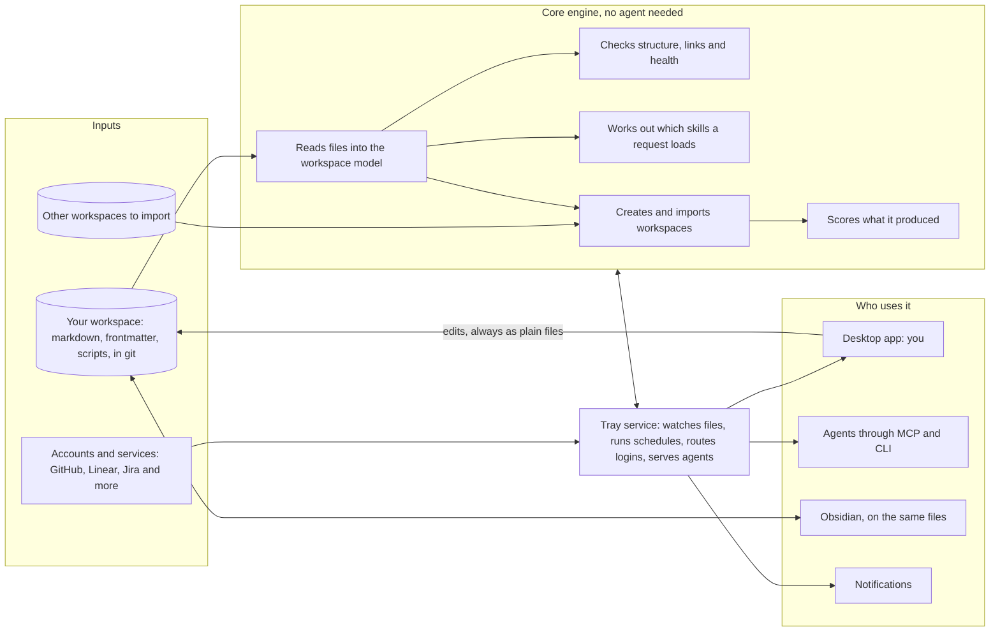

# The big picture

**TL;DR:** Synapse is a desktop app with an always-on tray service. It turns an AI workspace into something you can see, check and manage yourself. An AI workspace here means a folder of markdown, rules and scripts that agents read.

- **It edits the plain files directly,** the same ones agents and Obsidian use, so both keep working.
- **It runs its checks without an agent.** A connected agent adds judgment on top.
- **It creates new workspaces** (the generator).
- **It brings in existing ones** (the importer).
- **It keeps each persona's accounts and tools apart.** That part is this morning's credential plan, now one module.

Your workspace is the reference the app is measured against.

_"Synapse" is the codename (renamed from Synapse on 2026-10-14). A synapse is where signals pass between nerve cells; this app is where work, knowledge and logins pass between personas, domains and tools. Every place the name appears is tracked in the [name ledger](../NAMING.md), so a legal or branding change is a mechanical swap._

## What changed today, and why

| | This morning | Now |
|---|---|---|
| The product | A credential router | A workspace app. Credential routing is one module, **Personas & access**. |
| The real problem | Tools use the wrong account | The workspace is powerful but invisible. Seeing or steering it takes long sessions with an agent. |
| The generator | A later add-on, if sold | Core. Create, import and measure workspaces. |
| Your workspace | Something the tool serves | The north star, the first import and the test reference |

## The product on one page

_Legend: cylinders are stored data. Rectangles are parts or steps. Arrows show what flows where. A two-headed arrow means both directions._

## Principles

1. **Files are the source of truth.**
   - The app reads and writes the formats agents and AI-focused users already use: `AGENTS.md`, `SKILL.md` (the open Agent Skills format), MCP, `llms.txt`, and markdown with YAML frontmatter and `[[wikilinks]]`.
   - Any index the app builds is a cache. It can be deleted and rebuilt from the files.
2. **Scripts live in the workspace in their own language.**
   - Python, Rust, TypeScript or whatever an agent chose.
   - Each one carries a small manifest saying how to run it, so the app and any agent can use it.
3. **Agent optional, agent enhanced.**
   - Checks, routing and fixes run as plain programs.
   - A connected agent adds judgment.
   - **Agents discover; code enforces.** When an agent finds the same kind of problem twice, it becomes a deterministic check. This is your workspace's close-out and self-improve rule, built into the product.
4. **Your workspace is the north star.** Generated and imported workspaces must handle the kind of work yours does. Fixes found along the way flow back to yours, through its normal review.
5. **Measured, not assumed.** Every create, import and scan run produces a scorecard. Releases have number gates.
6. **Never edit silently.**
   - Edits from Obsidian, agents or git are welcome.
   - If one breaks the structure, the app proposes a fix and you accept it.
7. **Personas are walls you define.** Work and personal are defaults. You can split by app, or by separate installs of the same app.
8. **Product-grade security from day one,** whether it stays personal or is sold.
9. **Mac and Windows from the start.** Linux is designed for and comes later.

## The modules

| Module | What you do there | Grows from (in your workspace today) |
|---|---|---|
| **Home** | Status, pending items, projects, health at a glance | The session-start card (`session-status.py`) |
| **Library** | Read and edit notes, with frontmatter shown as form fields, backlinks and outlines | Obsidian and the vault conventions |
| **Graph** | 2D and 3D maps of domains, skills, knowledge and projects | Obsidian's graph, the Juggl plugin |
| **Domains & skills** | Browse domains → areas → hubs → spokes, foundations, lenses and frameworks. See exactly what a request would load. | `skills.registry.json`, `skill-loadset.py`, `trigger-routes.json` |
| **Health** | Run and read the doctor, harness, validators and optimize. Fix issues. | `workspace-harness.py`, `ws-doctor`, `nightly.py`, `/optimize` |
| **Projects** | Batons, next actions, pending items, sessions | `SESSION-STATE.md`, `project-context.md`, the session log |
| **Personas & access** | Personas, accounts, app installs, walls, limits | This morning's plan, now in [access/](access/00-overview.md) |
| **Integrations** | MCP, CLI and API connections per persona | `capability-registry`, MCP configs |
| **Create** | Make a new workspace through guided setup | `wsx` 0.3 (project 18) |
| **Import** | Bring in an existing workspace and find its issues | `wsx examine`, `consume`, `diagnose`, `restructure` |
| **Agents** | Connect agents, give them jobs, review what they propose | `workspace_mcp.py`, the Claude hooks |
| **Plugins** | Add views, checks, importers, surface adapters, integrations | New |
| **Automations** | Schedules and file watchers | `nightly.py`, hooks |

Each module is specified in [App experience](03-app-experience.md). The parts behind them are in [Architecture](02-architecture.md).

## Agent optional, agent enhanced

| Capability | Without an agent | With an agent connected |
|---|---|---|
| Health checks (doctor, harness, validators) | Full | Explains issues and drafts fixes |
| Optimize | Every mechanical probe: orphans, staleness, drift, token budgets | Adds judgment: consolidations, contradictions, rewrites, all as proposals |
| Import | Inventory and rule-based mapping | **Required for the first version:** a deep scan that follows every path |
| Create | Guided setup from templates | Interview, skills written for you, overlap reconciliation |
| Routing and load sets | Full | — |
| Writing a skill | Form, template, live validation | Drafts the content |
| Always-on logic | Watchers and schedules | Agent jobs on a schedule, such as a nightly optimize with judgment |

## What "north star" means in practice

- **A pinned snapshot.** The app works from a snapshot of your workspace at a fixed commit, in a sandbox folder. It never touches the live checkout.
- **Nothing left behind.** The importer must bring in **everything**: skills, hubs, foundations, frameworks, knowledge, memory, projects, references, routes, tools, adapters and logic. Each item is either mapped or listed as excluded, with a reason.
- **Same kind of work.** A workspace the app generates must support the same patterns as yours:
  - routing a request to a load chain
  - lenses that run after work
  - batons for handoffs
  - walls between personas
  - the session card
  - the harness checks
- **Fixes go both ways.** Issues the scanner finds in your workspace come back to you as proposals, and you decide.

**Early signs the scanner is needed** (today's census, to be explained by the first scan, not judged yet):

- 308 skills across 13 domains: 22 foundations, 45 hubs, 188 spokes, 53 cross-cutting lenses.
- **20 of the 45 hubs have no spokes.**
- **The design domain alone has 26 hubs.** It includes likely overlaps, such as `motion` beside `lead-motion-designer`, `type` beside `lead-type-designer`, and four design-system hubs.
- **Project-specific skills sit beside domain hubs,** for example `legion-project` and `omni-project`.

## Your domain idea

You're partly describing what exists, and partly adding something new and worth doing.

- **What exists.** Every skill carries a `domain` tag in its frontmatter, the small block of labelled fields at the top of a file. There are 13 values: design, engineering, game, quality, workspace, data, imaging, accessibility, product, science, vision, security and career.
- **What's missing.** A domain is only a tag. It has no file, no description and no owner. Hubs are not domains either: design has 26 of them.
- **The proposal.** Make **Domain** a real thing in the model, with its own file. A domain holds:
  - **areas** (UI, UX, 3D, type, motion…), each led by one hub
  - **foundations**, which load first
  - its **frameworks** and **knowledge**
  - its **lenses**

  Spokes sit under hubs as now. Each file keeps only light tags pointing upward (its domain, its hub). That matches your "lightweight connection tags."
- **On screen.** Domains are the large regions of the graph. Areas are clusters inside them, and spokes sit around their hub.

The full rules are in the [workspace model](01-workspace-model.md#domains-areas-and-hubs).

## How your existing projects fold in

| Project or piece | What happens to it |
|---|---|
| 18 — bootstrap generator (`wsx` 0.3) | Becomes the reference design and test oracle for Create and Import. Its interview, profile, resolver, emitter and adapters are the starting design. Once the app reaches parity, it is archived into this project with provenance. |
| 19 — your workspace | North star, first import, and the place fixes flow back to |
| 26 — this morning's credential plan | Becomes the Personas & access module in `plan/access/` |
| 25 — Fontface | Same stack. Shares the app shell, signing and release pipeline. |
| `09-tools` scripts | Run as checks through tool manifests from day one. Ported into the engine only where speed or packaging needs it. |
| `workspace_mcp.py` | The starting point for the app's agent bridge |

## Out of scope for now

- Hosting workspaces in the cloud.
- Live multi-user editing.
- Replacing git or Obsidian.
- A mobile app.

## Plan documents

1. [Big picture](00-big-picture.md), this page
2. [Workspace model](01-workspace-model.md): every kind of thing in a workspace, its file, fields and connections. Includes domains.
3. [Architecture](02-architecture.md): the parts, how they talk, technology, repo layout
4. [App experience](03-app-experience.md): tray, screens, key journeys
5. [Create and import](04-generator-and-importer.md): the generator, the importer and the agentic scanner
6. [Measurement](05-measurement.md): scorecards, test workspaces, release gates
7. [Security](06-security.md): risks across the whole app
8. [Roadmap](07-roadmap.md): stages, tracks, first steps
9. [Commercial path](08-commercial-path.md)
10. [Decision log](decisions.md)
11. Module detail: [Personas & access](access/00-overview.md), with its systems, integrations, flows, security, Vaultwarden and phases

## Open decisions

1. **The public name.** "Synapse" is a codename. Several software products already use the word, so a public name needs a trademark check. The [name ledger](../NAMING.md) makes the swap mechanical.
2. **Frontmatter placement.**
   - Your extra fields (`tier`, `hub`, `domain`) sit at the top level today.
   - The Agent Skills format may expect extras under a `metadata` block.
   - Stage 0 checks the current spec. Recommendation: keep them at the top level unless the standard rejects that.
3. **Generator engine.**
   - Recommendation: build the new model, parser and checks in the Rust core from the start.
   - Keep running the existing Python tools through manifests.
   - Rebuild Create in the core, using `wsx` as the spec and the test oracle.
4. **Plugin runtime.**
   - Recommendation: logic plugins as MCP servers (any language, separate process), with UI panels in a sandbox.
   - The alternative is WebAssembly components.
5. **The domain map.** Which areas each domain has is decided after the first scan, with you.
