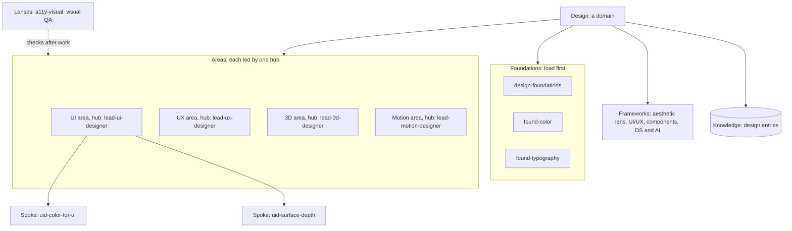
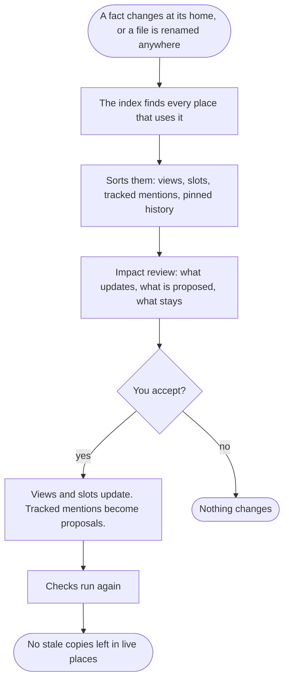
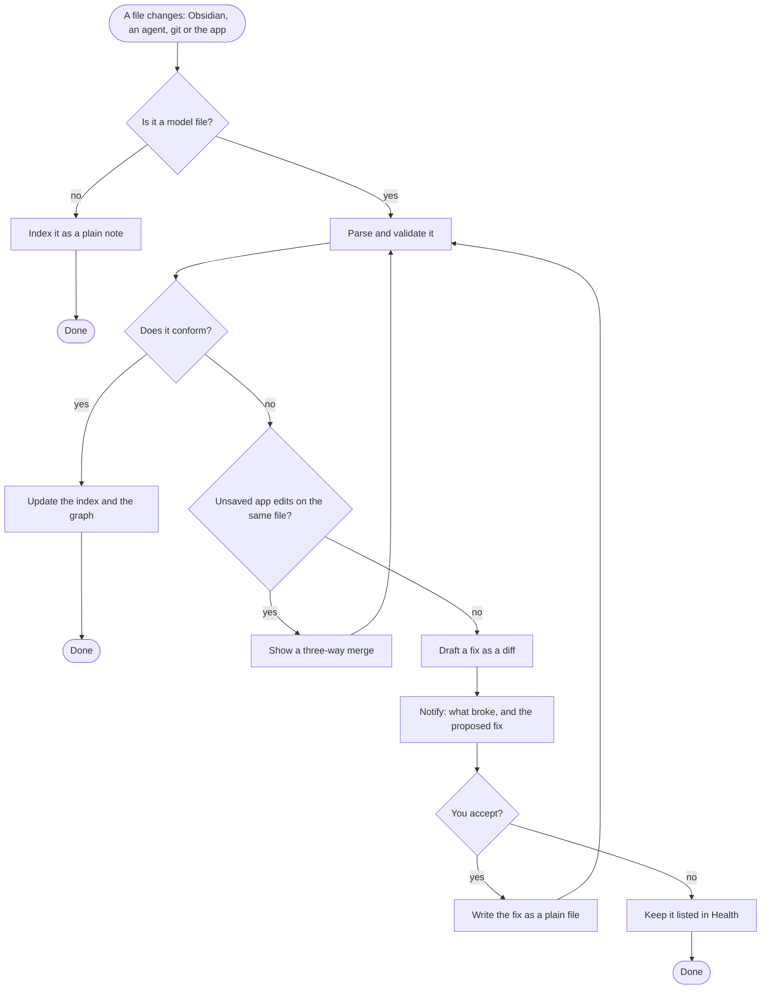

# Workspace model

**TL;DR:** The workspace model defines every kind of thing in a workspace: which file it lives in, which fields its frontmatter carries, and how it connects to other things. Everything else is built on it: the viewer, the graph, the health checks, the generator, the importer and the scores. It is written as a versioned spec plus machine-readable schemas (JSON Schema). Every file stays readable markdown that a person or any agent can open.

## Formats we read and write

- **`AGENTS.md`:** the shared instruction file most coding agents read.
- **`SKILL.md`:** the open Agent Skills format. A folder holds a `SKILL.md` whose frontmatter carries at least `name` and `description`.
- **MCP:** the Model Context Protocol, for tools agents call.
- **`llms.txt`:** a machine entry point listing what to read.
- **Markdown with YAML frontmatter and `[[wikilinks]]`:** the Obsidian dialect.
- **JSON manifests,** checked by JSON Schema.
- **Surface adapter files** (`CLAUDE.md`, `.cursor/rules`, `GEMINI.md` and the like). These are **generated** from the canonical files and never edited by hand.
- **Tools** in any language, each with a `tool.json` manifest.

Stage 0 checks each standard's current version. See the open decision on frontmatter placement in the [big picture](00-big-picture.md#open-decisions).

## Node types

| Type | What it is | Lives in | Key fields | In your workspace today |
|---|---|---|---|---|
| **Workspace** | The root | `AGENTS.md`, `llms.txt`, `workspace.json` | name, model version, layout | `AGENTS.md`, `workspace-manifest.json` |
| **Persona** | A side of life with its own accounts, apps and walls: work, personal or anything you add | `personas/<id>.md` | id, class, devices, surface instances, integrations, conduct rules | Context profiles, `devices.json`, the credential-scoping memory |
| **Domain** | A body of knowledge: design, engineering, game… | `domains/<id>/DOMAIN.md` | areas, foundations, frameworks, knowledge, triggers | Only a `domain:` tag (13 values) |
| **Area** | A part of a domain, led by one hub: UI, UX, 3D… | Declared in its domain file | id, hub | Implied by hubs |
| **Foundation** | Principles that load first | `SKILL.md`, `tier: foundation` | domain, triggers | 22 |
| **Hub** | The lead voice and entry point of one area | `SKILL.md`, `tier: hub` | domain, area, triggers, prerequisites | 45 |
| **Spoke** | A specialty skill | `SKILL.md`, `tier: spoke` | hub, governed_by | 188 |
| **Lens** | A cross-cutting check applied after work | `SKILL.md`, `tier: cross-cutting` | governs | 53 |
| **Framework** | An operating model. Highest doctrine. | `frameworks/NN-*.md` | id, domains, governs | 18 |
| **Knowledge entry** | Insight learned from real work, with freshness | `knowledge/<domain>/*.md` | triggers, as-of date, confidence, relations | 128 |
| **Memory entry** | A decision, fact, feedback or reference, outside any project | `memory/*.md` | type, relations, confidence | 46 |
| **Project** | A body of work with a baton | `projects/NN-name/` (README + `SESSION-STATE.md`) | status, persona, repo, triggers | 28 |
| **Session** | One session's record and handoff | `sessions/<id>.md`, session log | agent, surface, machine | Fragments + log |
| **Artifact** | A generated deliverable | `artifacts/` + registry | version, date, source | `05-artifacts/` + registry |
| **Reference** | A standard or spec others follow | `references/` | — | 27 markdown, 34 JSON |
| **Route** | A trigger phrase and what it loads | `routes.json`, knowledge hints | triggers → targets | 314 routes |
| **Tool** | A script or program | `tools/<name>/` + `tool.json` | language, entry, runtime, safety, implements | 47 Python scripts, no manifests |
| **Check** | A rule that passes or fails | Declared by a tool or the engine | applies to, severity, fix | Harness gates, close-out detectors |
| **Surface** | An agent app, with one or more installs | `surfaces.json` (the surface catalog) | detection, read locations per level, formats, limits, precedence, writable or guided, test signal, instances (persona, path, account) | `surfaces.json` (22 surfaces), `SURFACES.md` |
| **Install record** | What Synapse wrote into another app's config: where, at which level, with its fingerprint and backup | The app's local data folder (per device, never synced) | surface instance, path, fingerprint, backup | The doctor's installs, tracked by hand |
| **Sealed note** | A note you chose to encrypt. Its header is readable; its body opens only through Synapse or your recovery key. | Anywhere in the workspace, flagged in frontmatter | persona, reason | None |
| **Integration** | A connection to an outside service by MCP, CLI or API | `integrations/*.json` | kind, persona, identity, capability | `capability-registry` |
| **Identity** | An account at a provider | Secure storage + policy | provider, account, persona | See [access](access/03-how-it-works.md) |
| **Adapter** | A generated surface file | Generated | source, target | `CLAUDE.md`, `.cursor/rules`, wrappers |
| **Plugin** | An extension | `plugins/<id>/plugin.json` | permissions, contributions | None |
| **Device** | A machine | `devices.json` | OS, personas | `devices.json` |
| **Fact** | A value other files repeat, with one home: a field on the node it describes | A frontmatter field on its home node | type, value, live or pinned uses | Copied by hand today |
| **View** | A generated block built from facts | Between `<!-- synapse:view -->` markers | source query, format | None. `project-context.md` and the registry are hand-kept. |

**Folders are not fixed.** A node's type comes from its frontmatter `type` (or `tier` for skills) plus a **layout map** that says where each type lives. Your numbered folders (`00-bootstrap` … `09-tools`) and a fresh generated layout are both valid. This is the "dialect" idea from `wsx consume`, made formal.

## Connections (edges)

| Edge | From → to | Hard or soft | Declared by |
|---|---|---|---|
| `belongs_to` | Any node → domain, area or project | Soft (grouping) | `domain`, `area`, `project` fields |
| `hub` | Spoke → hub | **Hard:** load the hub first | `hub` field |
| `prerequisite` | Skill → skill | **Hard** | `prerequisites` |
| `related` | Node → node | Soft: suggest, never auto-load | `related` |
| `governed_by` / `governs` | Skill ↔ lens | Lens runs **after** output | `governed_by`, `governs` |
| `defers_to` | Skill → skill or framework | Wins on conflict | `defers_to` |
| `builds_on`, `relates_to`, `supersedes` | Knowledge or memory → node | Typed relation | `relations` |
| `routes_to` | Route → node | Load hint | Route files |
| `implements` | Tool → check | — | `tool.json` |
| `applies_to` | Check → node type | — | Check declaration |
| `owns` | Persona → project, identity, surface instance, integration | Wall boundary | Persona file |
| `generated_from` | Adapter → source | Never hand-edit the target | Generator |
| `link` | Any → any | Untyped | `[[wikilink]]` in the body |
| `instance_of` | View or slot → fact | Live: updates after review | View and slot markers |
| `mentions` | Tracked plain mention → fact | Live or pinned. Proposals only. | The index |

Every edge records its source, target, kind, whether it is hard, and where it was declared. That makes "why is this connected?" answerable in the app.

## Stable IDs

**Every node gets a permanent ID** when it is created or first imported: a short random code such as `n-7f3k9q`. The ID never changes. It is never built from a name, so a title in any language can't produce a fragile ID.

- **Names, numbers and folders become properties.** Renaming a project, renumbering it (Fontface went from 24 to 25) or moving its folder changes properties, not identity.
- **Renames outside the app still work.** A file moved in Finder, renamed in Obsidian or moved with `git mv` keeps its ID in its frontmatter. The index sees a move, not a deletion plus a new file.
- **Wikilinks stay as they are,** so Obsidian keeps working. When something is renamed, the app updates the wikilinks that point to it, as Obsidian's own "update links" setting does, and shows the change first.
- **Where the ID lives:** an `id` field in frontmatter. In a skill it sits under `metadata`, to stay within the Agent Skills spec.

## Domains, areas and hubs

This is your domain idea, made concrete.



_Legend: solid arrows mean "contains." The dotted arrow means a lens checks the work afterwards. The cylinder is stored knowledge. Area names are examples. The real map is set after the first scan._

**Rules:**

1. **One primary domain.** Every foundation, hub, spoke and knowledge entry belongs to one domain. It may reference others.
2. **One hub per area,** and each hub leads one area.
3. **Light tags only.** A spoke names its hub. Its area and domain follow from that. Extra tags are allowed only if they agree, and a check enforces it.
4. **Lenses and frameworks attach at domain or workspace level.**
5. **Project skills belong to their project,** not to a domain area. Examples are `legion-project` and `omni-project`. On the graph they sit near the project.
6. **Load order doesn't change:** foundation → hub → spoke, with lenses after the work.

**What this would likely clear up** (the scan decides; nothing is pre-judged):

- the 26 design hubs settling into a smaller set of areas
- hubs without spokes becoming areas in waiting, or spokes
- overlaps that become visible once they share an area

## File contract: examples

**A domain** (`domains/design/DOMAIN.md`):

```yaml
---
type: domain
id: n-2m9d1a
id: design
name: Design
summary: Visual, interaction and system design for screens and brands.
areas:
  - { id: ui, hub: lead-ui-designer }
  - { id: ux, hub: lead-ux-designer }
  - { id: 3d, hub: lead-3d-designer }
  - { id: motion, hub: lead-motion-designer }
foundations: [design-foundations, found-color, found-typography, found-composition, found-hierarchy, found-perception]
frameworks: [01-aesthetic-lens, 02-ui-ux-operational, 09-component-and-pattern, 18-design-systems-ai]
knowledge: knowledge/design/
triggers: [design, visual design, ui, ux]
model_version: "3.0"
---
```

The body below the frontmatter says, in plain words, what the domain covers, what it doesn't, and how its areas relate.

**A hub** (`skills/lead-ui-designer/SKILL.md`), in the proposed spec-clean layout: workspace fields under `metadata`, pending the Stage 0 check:

```yaml
---
name: lead-ui-designer
description: Lead UI designer lens for screens, components and visual hierarchy…
metadata:
  id: n-4q8w2c
  tier: hub
  domain: design
  area: ui
  triggers: [ui design, interface, screen design]
  prerequisites: [design-foundations]
  governed_by: [a11y-visual, visual-qa-ui-design]
  spec_version: "3.0"
---
```

**A tool** (`tools/validate-links/tool.json`):

```json
{
  "id": "n-8c1v5t",
  "name": "validate-links",
  "language": "python",
  "entry": "09-tools/validate-links.py",
  "runtime": "python>=3.11",
  "safety": "read-only",
  "network": false,
  "implements": ["check:skill-edges-resolve"],
  "run": { "check": [] },
  "output": "text-report"
}
```

**A persona** (`personas/work.md`):

```yaml
---
type: persona
id: n-6r3p0x
id: work
class: employer
conduct: branch-pr-review        # no self-merge, no push to the default branch
devices: [work-mbp]
surfaces: [claude-desktop@work, cursor]
integrations: [github-work, jira-work]
---
```

## Facts: one source, many places

**TL;DR:** A fact lives in one place. Everywhere else it is generated from that place, linked to it, or tracked against it. When it changes, you see the impact first, then live copies update and history stays as it was. It works the way a design-system component updates its instances.

**A fact** is a value that other files repeat, such as:

- a name, path or number
- a status or next action
- a version, owner, repo location or date

Each fact has **one home**: a field on the node it describes. A project's status lives in that project's baton and nowhere else.

**Three ways a fact can appear elsewhere:**

| Level | What the raw file looks like | Updates on its own? | Use for |
|---|---|---|---|
| **1. Tracked mention** | Plain text, no markup. The index remembers where the fact is mentioned. | No. Changes come back as proposals, because matching plain text can be wrong. | Most mentions |
| **2. Generated view** | One comment line before a block and one after, with normal Markdown in between | Yes, after review | Lists such as Active Projects or the project registry |
| **3. Inline slot** | A comment pair around one value | Yes, after review | Rare: only where a sentence must stay exact. Opt-in. |

Most files have no markers at all. A generated view in raw form:

```markdown
<!-- synapse:view projects-active -->
- **Synapse:** Planning. Next: Sean reviews the plan.
- **Fontface:** Phase 1 built. Next: scan fixes.
<!-- /synapse:view -->
```

An inline slot, used sparingly:

```markdown
The repo lives at <!-- synapse:fact n-7f3k9q.repo -->~/Projects/synapse<!-- /synapse:fact -->.
```

**Live or pinned.**

- **Live** references follow the source.
- **Pinned** references keep the value as it was. Session logs, decision rows, commit messages and history sections are pinned by default, so cleanup never rewrites the record. This is like linking to a published library version rather than the latest.

**Changing a fact:**



_Legend: rounded boxes start or end the flow. The diamond is your decision. Rectangles are steps._

**Hand edits to linked values (override or detach).** Someone may edit a slot or view by hand, in Obsidian or through an agent. The app then asks:

- **Push:** make this the new source value.
- **Reset:** put the source value back.

A slot can also be **detached** into plain text on purpose. These are the same choices Figma gives for component instances.

**Catching copies that aren't linked (drift).**

- **How:** the index knows every fact's current value. A check looks for old or different values where that fact is mentioned, and flags each with a confidence level.
- **Care with common words:** short values like "Planning" are only checked in expected places, such as status lines, not across all prose.
- **Fixing:** an accepted fix can turn the mention into a slot.
- **Why it matters:** this is how an existing workspace moves over gradually, and how copies written by agents get caught.

**Never automatic:**

- rewriting prose
- anything pinned

**The codename is a fact too.** Its home is the brand file. Every place it appears is a view, slot, tracked mention or pinned record. Renaming the app for branding or legal reasons is an ordinary fact change with an impact review (decisions D37 and D43).

## Readable without Synapse

**Every file must read correctly and completely with Synapse uninstalled.** This rule outranks every convenience.

- **No new syntax.** Markdown has no standard for variables or includes. CommonMark and GitHub's Markdown have neither. Synapse adds only HTML comments, which are valid everywhere and hidden when rendered on GitHub, in VS Code's preview and in Obsidian's reading view.
- **No dialects in files Synapse writes.** That means no Obsidian embeds, Dataview queries, MDX or directives. Ones you already have are kept as they are.
- **Values are always written in.** Nothing is filled in only when read, so a file copied to another machine, tool or person stays correct.
- **Markers are rare.** Views and slots are the only markup, and most files have neither.
- **One deliberate exception: sealed notes (opt-in).** Their header stays readable. Their body is encrypted in the open `age` format, which your recovery key can open without Synapse. See [Accounts, linking and encryption](06-security.md#accounts-linking-and-encryption).

## Agent Skills compliance

- **Top-level frontmatter keeps to the spec's fields:** `name`, `description`, `license`, `compatibility`, `allowed-tools` and `metadata`.
- **Workspace fields move under `metadata`:** `id`, `tier`, `hub`, `area`, `domain`, `triggers`, `governed_by` and the rest.
  - Stage 0 confirms whether `metadata` may hold lists.
  - If it can't, routing lists move to a small file inside the skill folder, which the spec allows.
- **No live slots in a skill's frontmatter.** `name` and `description` are what agents load first to pick a skill, so they stay plain and stable.
- **Your 308 skills migrate by script,** with a diff preview first.

## Values, languages and formats

**Stored standard, shown local.** The data never changes with the viewer. Only its presentation does, the way a backend sends raw values and the interface formats them.

| Kind | Stored as | Example |
|---|---|---|
| Date | ISO 8601 | `2026-10-14` |
| Date and time | ISO 8601 with a time-zone offset | `2026-10-14T16:15:00-07:00` |
| Money | Amount plus ISO 4217 currency code | `1250.00 USD` |
| Number | Dot for decimals, no grouping | `1250.5` |
| Duration | ISO 8601 | `P2W` (two weeks) |
| Language | BCP 47 tag | `en-US`, `de-DE` |

- **Files hold the standard form too.** Views and slots write `2026-10-14`, not "Oct 14". Two devices with different region settings never fight over the same file, and agents always read one unambiguous form.
- **Only the app shows local formats.** Dates, numbers and money appear in your region's style in the app's screens.
- **Optional workspace file locale.** A workspace written in another language can choose to have its views and slots formatted for that language. It's a workspace setting, not a device setting, so it stays stable across machines.

**Detecting the region on first run, without prompts:**

1. **The OS's regional-format setting:** what you picked for dates and numbers in macOS or Windows settings. This is the most accurate source, and it isn't location data.
2. **The OS language.**
3. **The time zone,** only as a hint when the above are missing.
4. **A neutral default:** standard ISO forms.

The app never uses IP lookups, GPS or location services. So there's no permission prompt and no privacy cost.

**You can override everything** in Settings → Region and formats, per device, and optionally per persona:

- date style
- 12- or 24-hour time
- first day of the week
- number separators
- currency display

**Reading values back** (for drift checks on tracked mentions):

- The parser uses the workspace locale.
- Ambiguous forms such as `10/11/2026` (October 11 or 10 November) are flagged at low confidence and never changed automatically.

**Text in any language:**

- **Unicode normalization (NFC),** so the same word stored two ways still matches.
- **Language-aware upper and lower case,** for example Turkish dotted and dotless i.
- **A search tokenizer for languages written without spaces,** such as Chinese and Japanese.
- **Right-to-left text** in the editor.

**Routing in any language.** The schema allows trigger phrases per language from the start, even though yours are English today.

**Interface text** lives in translation files from day one. The brand file holding the app's name is one of them.

## Versioning and migration

- **One model version for the workspace,** in `workspace.json`. Each node type's schema has its own version.
- **Today's skill frontmatter spec is v2.x.** Model 3.0 adds `type`, `area`, domain files, persona files and tool manifests.
- **Migrations are scripts.** They show a diff first, apply only on approval, and git can undo them.

## Outside edits and conformance

Obsidian, agents and git can all change files while the app runs. The app watches, checks and proposes. It never rewrites silently.



_Legend: rounded boxes start or end the flow. Diamonds are questions. Rectangles are steps._

**Coexisting with Obsidian plugins that also write.** Your vault runs Linter, Templater and others. The app notices when it and another writer keep changing the same file back and forth. It stops and asks, instead of fighting.

## Checks the model enables

Most of these exist today as `09-tools` scripts. The model gives each one a stable name, a target node type and a fix.

| Family | Examples |
|---|---|
| Structure | Frontmatter matches the schema. `name` matches the folder. Required fields are present. |
| Links | Wikilinks and edges resolve to tracked files. No dangling links. |
| Reachability | Every hub and foundation can be reached by some route. Well-formed isn't the same as reachable. |
| Load chains | Acyclic, foundation-first, hard edges kept to 0–2 per skill |
| Doctrine | `defers_to` and `governed_by` point at real lenses and frameworks |
| Freshness | Stale dates and aging claims in knowledge and memory |
| Token budgets | Session floor and worst-case load stay under budget |
| Walls | No employer content in personal areas, and no employer data leaving its devices |
| Secrets | No tokens or keys in any file |
| Generated files | Adapters and wrappers aren't hand-edited |
| Identity | Every node has an ID. No duplicate IDs. Moved files keep theirs. |
| Facts | Views and slots match their source. Views aren't hand-edited. Tracked mentions that disagree with the source are flagged. |
| Values | Stored values use standard forms: ISO dates, currency codes, dot decimals |
| Skills spec | Top-level skill frontmatter keeps to the Agent Skills fields |
