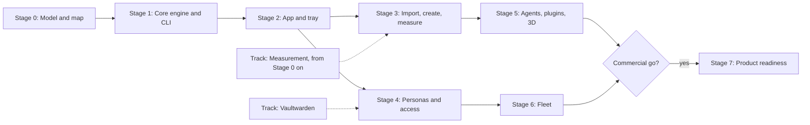

# Roadmap

**TL;DR:** Seven stages, plus tracks that run throughout.

- **Stage 0** defines the workspace model and scans your workspace, before any app code exists.
- **Stages 1–3** build the engine, then the app you use daily, then create, import and measurement.
- **Stages 4–6** add personas and access, agents and plugins, and multi-device sync.
- **Stage 7** happens only if you decide to sell it.

Each stage ships something you use, on Mac and Windows.

## Order of work

_Legend: solid arrows mean "needs the earlier stage." Dotted arrows show a track feeding a stage. The diamond is your decision._

**Stages 3 and 4 can run in either order.** The model and the generator come first because you named them as the biggest part. If login trouble gets worse, Stage 4's first two phases (Watch, then Broker) can move ahead of Stage 3. They don't depend on the importer.

## Effort

Sizes are in **focused weeks**: full-time-equivalent weeks of building with agent help. Calendar time depends on the hours you give it. Each stage includes about 30% for Windows.

| Stage | Size |
|---|---|
| 0 Model and map | 3–5 |
| 1 Core engine and CLI | 6–8 |
| 2 App and tray | 8–10 |
| 3 Import, create, measure | 8–12 |
| 4 Personas and access | 10–15 |
| 5 Agents, plugins, 3D | 8–10 |
| 6 Fleet | 3–4 |
| **Through Stage 6** | **About 46–64** |
| 7 Product readiness | 8–12 or more, only after a go decision |

This is a long project. That is why every stage has to be useful on its own. Stage 0 will tighten these numbers.

## Done means (every stage)

- It works on macOS and Windows.
- The [security](06-security.md) review is updated, and the stage's test scenarios pass.
- The [measurement](05-measurement.md) gates that apply are met.
- It can be uninstalled cleanly.
- The docs match the build.
- It ships as a signed release.

---

## Stage 0: Model and map

**Goal:** settle exactly what a workspace is, and see your workspace through that lens, before writing app code.

**Deliverables:**

- **Workspace model v1:** the spec plus JSON Schemas for every node type, including Domain, Area, Persona, Tool and Surface instances.
- **Standards check:** current Agent Skills, `AGENTS.md` and MCP specs, and the frontmatter placement decision.
- **A sandbox snapshot** of your workspace at a pinned commit.
- **The first deep scan.** An agent session follows a written scan protocol, the manual version of the future scan job, on that snapshot. It produces a findings report, a coverage ledger and a **proposed domain and area map** for your review.
- **Measurement v0:** coverage, edge fidelity and routing equivalence, using today's CLIs. Baseline numbers.
- **Refined diagrams** of Create and Import, updated with what the scan teaches.
- **Spikes:**
  - CodeMirror editing your files without changing a byte
  - index speed
  - the 3D graph on the Windows PC
  - the file watcher alongside Obsidian Linter
  - `tool.json` written for five existing tools
- **The repo:** `~/Projects/synapse` with remote `snds/synapse`. These plans move to its `docs/`.
- **Name ledger:** one brand file for every user-facing use of the name, neutral `sy` internal identifiers, and a check that lists every place the codename appears and fails on any it doesn't know about. This keeps a rename for branding or legal reasons mechanical. See decision D37.

**Exit:**

- You approve model v1 and the domain map.
- Baselines are recorded.
- The spikes are answered.

---

## Stage 1: Core engine and CLI

**Goal:** an engine that understands your workspace as well as today's scripts do, then better.

**Deliverables:**

- Parser and index.
- Checks: the core validators ported, the rest wrapped through `tool.json`.
- A router that matches `skill-loadset.py`.
- The tool runner.
- The writer, with proposals.
- The `sy` CLI.

**Exit:**

- On your snapshot, the engine finds every issue today's validators find.
- Load sets match 100% on the request set.
- A full index takes under 3 seconds.

---

## Stage 2: App and tray

**Goal:** see and manage the workspace without asking an agent.

**Deliverables:**

- The tray service and desktop app on Mac and Windows.
- Screens: Home, Library, Domains & skills with the load simulator, Health, Projects, and the 2D graph.
- The file watcher with conformance proposals.
- Notifications.
- Optional: the access module's read-only Watch phase, since the tray now exists.

**Exit:**

- Two weeks where you check status in the app rather than asking an agent.
- Obsidian edits round-trip with no corruption.
- Windows parity.

---

## Stage 3: Import, create, measure

**Goal:** bring workspaces in and create new ones, with proof.

**Deliverables:**

- The import pipeline, with the deep scan as an agent job.
- Create (the generator, version 2), with forms and an agent interview.
- Scorecards, with corpus T1–T4 running in CI.
- The fix-back flow to your workspace.

**Exit:**

- Round-tripping your workspace meets every starting gate.
- Each T2 profile produces a workspace that passes all checks and task equivalence.
- `wsx` parity is reached, and project 18 is archived into this one with provenance.

---

## Stage 4: Personas and access

**Goal:** the right login and the right tools for each persona, everywhere.

**Deliverables:**

- The access module's phases: Watch → Broker → Gateway ([access/06-phases](access/06-phases.md)).
- Personas and app instances in the model, including duplicate installs.
- The Integrations screen.

**Exit:** as in the access phases, plus a duplicate-install setup (two Claude desktop apps, one per persona) routed correctly.

---

## Stage 5: Agents, plugins, 3D

**Goal:** the agent-enhanced half, and room to extend.

**Deliverables:**

- Agent bridge version 2.
- Agent jobs beyond scanning: optimize with judgment, skill drafting, overlap reconciliation, all on schedules.
- Plugin system version 1.
- The 3D graph.

**Exit:**

- A nightly agent job runs for two weeks with every output arriving as a proposal.
- One plugin of each kind is built.
- The 3D graph meets its performance targets.

---

## Stage 6: Fleet

**Goal:** devices stay in step.

**Deliverables:**

- The access module's fleet phase: hub, enrollment, removal, recovery kit.
- Per-device workspace settings.

**Exit:** as in the access phases.

---

## Stage 7: Product readiness

Only after the go decision. See [Commercial path](08-commercial-path.md).

---

## Tracks that run throughout

| Track | What | When |
|---|---|---|
| Measurement | Corpus, scorecards, gates | From Stage 0. Gates tighten each stage. |
| Security | Threat review and scenarios | Start of every stage |
| Vaultwarden | Deploy, back up, trial, cut over ([access/05-vaultwarden](access/05-vaultwarden.md)) | Any time. Independent of code. |
| Fix-back | Scanner findings proposed to your workspace | From Stage 0's first scan |

## What you'll be asked for

| Stage | Your part |
|---|---|
| 0 | Review the model and the domain map. Decide the frontmatter placement and the name. |
| 2 | Use it daily and say what's missing |
| 3 | Review import proposals for your workspace. Pick the T2 test profiles. |
| 4 | Sign in to accounts and set walls and limits |
| 7 | The commercial go or no-go |

## First steps

1. **You:** read the [big picture](00-big-picture.md) and mark anything that's off.
2. **On your go:** start Stage 0.
   - Create the repo and move the plans.
   - Take the sandbox snapshot.
   - Draft model v1.
   - Run the first deep scan for you to review.
