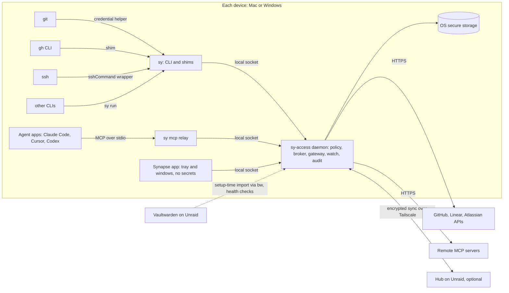

# Systems: what we build

**TL;DR:** Synapse has six parts. Four run on every device: the daemon, the command-line tool and shims, the MCP gateway, and the app. One is optional and runs on Unraid: the hub. The last is shared data: the policy file. Secrets live only in the daemon and the operating system's secure storage.

## The parts at a glance

| Part | Runs where | Holds secrets? | Job |
|---|---|---|---|
| `sy-access` daemon | Each device, as you, from login | Yes, in memory and OS storage | Decides, hands out, refreshes, watches, logs |
| `sy` CLI and shims | Each device, started by tools | No | Brings tool requests to the daemon |
| MCP gateway | Inside the daemon, plus a tiny `sy mcp` relay | Daemon side only | Lets agents use trackers with the right account |
| Synapse app | Each device, tray icon and windows | No | Shows status, notifications, settings and setup |
| Hub | Unraid container, optional | No, it stores only encrypted data | Passes rules and device lists between devices |
| Policy | A file on each device, synced | No | Your rules: identities, routes, walls, limits |

## 1. The daemon (`sy-access`)

The daemon is the only part that sees secrets. It runs as your user account and never as root or SYSTEM.

**What it does:**

- **Policy engine:** reads the policy, classifies each request's context, picks the identity, and enforces walls and limits.
- **Broker:** releases one credential for one request, to one checked caller, through the narrowest channel.
- **Token lifecycle:** runs sign-ins, refreshes short-lived tokens before they expire, and tracks expiry dates and permissions.
- **Gateway:** relays MCP traffic to tracker servers and attaches the right account on the way out.
- **Watch:** runs scheduled health checks and sends events to the app.
- **Audit:** writes a tamper-evident log of every decision.
- **Sync client:** talks to the hub when one is set up.
- **Adapters:** hands its MCP gateway entries to the app's [Surface installer](../02-architecture.md#9-surface-installer), which writes and checks each surface's config files.

**How it starts:**

- **Mac:** a per-user LaunchAgent, registered by the app through Apple's `SMAppService` (macOS 13 or later). launchd restarts it if it crashes.
- **Windows:** a per-user scheduled task that runs at logon and restarts on failure. It is not a Windows Service. Services run under other accounts and can't use your protected storage cleanly.

**States:**

- **Running, unlocked:** normal.
- **Running, class locked:** employer identities wait for a presence check. Personal ones keep working.
- **Locked:** after a restart, until you unlock. Requests wait briefly for Touch ID or Windows Hello, then fail.
- **Stopped:** tools fail closed with a clear message.

## 2. The command-line tool and shims (`sy`)

One small binary answers to several names. Each name is a door for a different tool. It holds no state and starts fast, because git calls it on every network operation.

| Entry point | Called by | What it does |
|---|---|---|
| `git-credential-sy` | git, through `credential.helper` | Asks the daemon for the credential for this URL in this repo |
| `gh` (shim placed first in PATH) | Anything that runs `gh` | Gets a token for this repo, then runs the real `gh` with `GH_TOKEN` set for that one process |
| `sy ssh` | git, through `core.sshCommand` | Picks the identity's key and runs `ssh` with only that key |
| `sy run -- <command>` | You or scripts | Runs any command with secrets placed in its environment from references like `sy://gh-personal/token` |
| `sy mcp <service>` | Agent apps, as a stdio MCP server | Relays MCP messages to the daemon's gateway |
| `sy status`, `explain`, `as`, `lock`, `doctor` | You | Status, "why this identity", one-off override, lock now, self-check |

If the daemon isn't running, every entry point **fails closed**. It hands out nothing and prints one line saying how to fix it.

## 3. The MCP gateway

Agent apps launch `sy mcp linear`, `sy mcp jira` or `sy mcp github` the same way they launch any local MCP server. The relay passes the app's working folder and process chain to the daemon. The daemon picks the identity for that project and opens the upstream connection with that account's token.

**Upstream modes:**

1. **Remote server with OAuth:** for example Linear's or Atlassian's hosted MCP server. Synapse acts as the OAuth client, one sign-in per identity. That is what makes two Linear workspaces possible side by side.
2. **Remote server with a fixed token:** a bearer token in the request header.
3. **Local server process:** Synapse starts the server, such as GitHub's own MCP server, with the token in that process's environment only.

**Tool policy:** each identity can allow or deny named tools, run read-only, or require your confirmation for writes. The token never reaches the agent app or the model.

An optional local HTTP endpoint exists for apps that only speak HTTP MCP. It is off by default. See [Security](04-security.md).

## 4. The app

A Tauri 2 desktop app with a tray icon (Windows) or menu-bar icon (Mac) and a main window. It talks to the daemon with a **UI role**. That role can manage rules and identities but can never read a secret value.

Main screens: Overview, Identities, Rules (with a rule tester), Surfaces, Devices, Activity and Settings. The details are in [How it works](03-how-it-works.md#the-app).

Notifications come from the app, because both operating systems tie notifications to an installed, signed app. The daemon queues events if the app isn't running.

## 5. The hub (optional)

A small server in a Docker container on Unraid, reachable only over Tailscale, your private network.

- **Stores:** encrypted policy versions, the signed device list, enrollment requests and optional encrypted health summaries.
- **Can't read any of it.** Devices encrypt with a fleet key the hub never has.
- **Can't forge any of it.** Devices sign everything, and receivers check the signatures.
- **Without a hub** you can still sync by exporting and importing a signed policy file or QR code.

Built with Rust (`axum`) and SQLite. Phase 4.

## 6. The policy

One human-readable TOML file per fleet, checked against a schema, versioned and signed when synced. The app's screens edit the same file. An example is in [How it works](03-how-it-works.md#the-policy-rules-you-write-once).

## Data the daemon keeps

| Data | Contents | Where | Secret? |
|---|---|---|---|
| Secure storage items | Access and refresh tokens, SSH private keys if managed, vault keys, fleet key | Mac: Keychain, this device only. Windows: Synapse's vault file, encrypted with a TPM-protected key | Yes |
| Device key | Proves which device is speaking | Mac: Secure Enclave. Windows: TPM. Neither can export it | Yes, and hardware-held |
| `policy.toml` + signature | Rules | App data folder | No |
| `state.db` (SQLite) | Identity metadata, token expiry and permissions, health results, notification history, adapter state | App data folder | No |
| `audit.log` | One line per decision, hash-chained | App data folder | No values, but sensitive metadata |
| Logs | Diagnostics, redacted | Logs folder | No |

**Folders:**

| | Mac | Windows |
|---|---|---|
| App data | `~/Library/Application Support/design.snds.sy/` | `%LOCALAPPDATA%\snds\sy\` (local, never roaming) |
| Logs | `~/Library/Logs/design.snds.sy/` | `%LOCALAPPDATA%\snds\sy\logs\` |
| Socket or pipe | `~/Library/Application Support/design.snds.sy/run/sy-access.sock` (folder mode 0700) | `\\.\pipe\sy-access-<user SID>` (your account only) |
| Shims | `~/Library/Application Support/design.snds.sy/bin` (added to PATH) | `%LOCALAPPDATA%\snds\sy\bin` (added to your user PATH) |

## Local message protocol

The daemon, CLI and app talk over the socket or pipe using length-prefixed JSON-RPC, a simple request-and-reply message format.

- **Versioned:** each side states its protocol version. Mismatches fail cleanly.
- **Strict:** messages have size limits, unknown fields are rejected, and the parser is fuzz-tested.
- **Roles:**
  - **Helper:** shims and the relay. They may request credentials, subject to policy and caller checks.
  - **UI:** the app. It may manage everything except reading secrets.
  - **Admin CLI:** like UI. Sensitive commands need a presence check.
- **Caller check:** on every connection the daemon asks the OS which program is calling, then verifies its code signature. See [Security](04-security.md#2-release-who-gets-a-secret-and-when).

## Technology choices

| Layer | Choice | Why |
|---|---|---|
| Core language | Rust | Precise control of secret memory (wipe after use, no copies left by a garbage collector). Small, fast binaries for the credential helper. Builds natively for Mac and Windows. |
| App shell | Tauri 2 | Tray, notifications, autostart, single instance and signed updates on both OSes. Same stack as Fontface. |
| UI | React 19 + TypeScript + Vite | Same as Fontface, so components and tooling carry over |
| MCP | `rmcp`, the official Rust MCP SDK | Tracks the spec, including OAuth |
| HTTP and TLS | `reqwest` + `rustls` | No OpenSSL dependency |
| OAuth | `oauth2` crate | Device flow, PKCE, refresh |
| Mac security | `security-framework` + small Swift helpers if needed | Keychain access groups, Secure Enclave, Touch ID |
| Windows security | `windows` crate | DPAPI, CNG with the TPM, Windows Hello, named pipe access lists |
| Crypto | RustCrypto (`chacha20poly1305`, `p256`, `ed25519-dalek`), `zeroize`, `secrecy` | Audited, pure-Rust building blocks with memory wiping |
| Storage | SQLite (`rusqlite`) | One file, reliable |
| Logging | `tracing` with a redaction layer | Secret types can't be printed |
| Hub | `axum` + SQLite in a Docker image | Small, one container |

These are candidates. Phase 0 confirms them with spikes. See the [Implementation plan](06-phases.md).

**Rejected:**

- **SwiftUI:** Mac only.
- **Go with Wails:** workable, but the garbage collector makes wiping secrets from memory unreliable, and it would be a second stack beside Fontface.
- **Electron:** heavy, with a larger attack surface for a tool that brokers credentials.

## Repository layout

The access parts live in the app's single repository. See the [architecture repository layout](../02-architecture.md#repository-layout-planned): `sy-access` (this process), `sy` (the CLI and shims) and `sy-hub`. Their policy, routing and wall logic has no OS code, so it is tested the same way on every platform.
