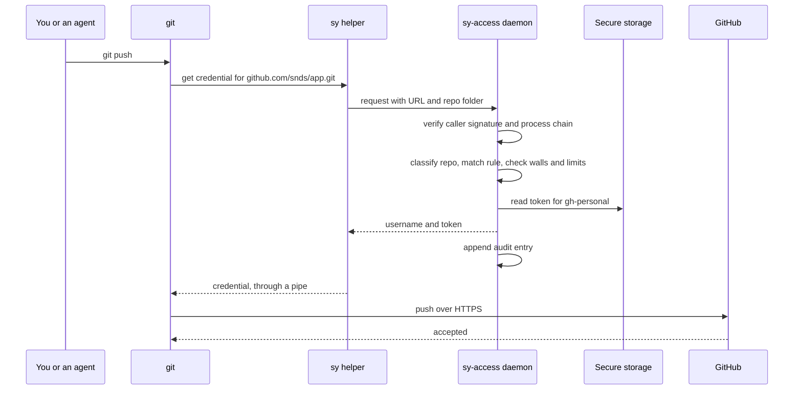
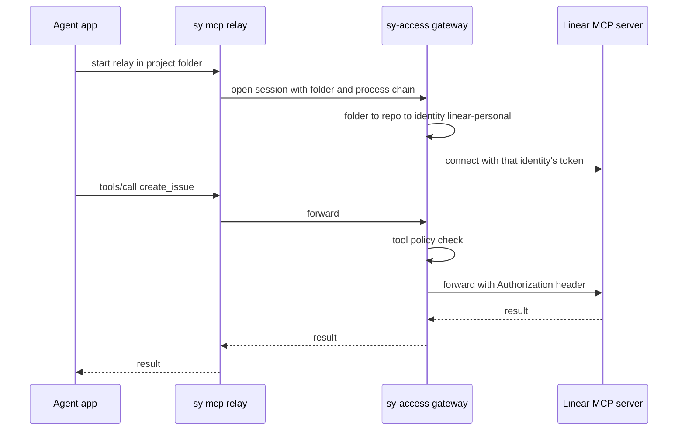
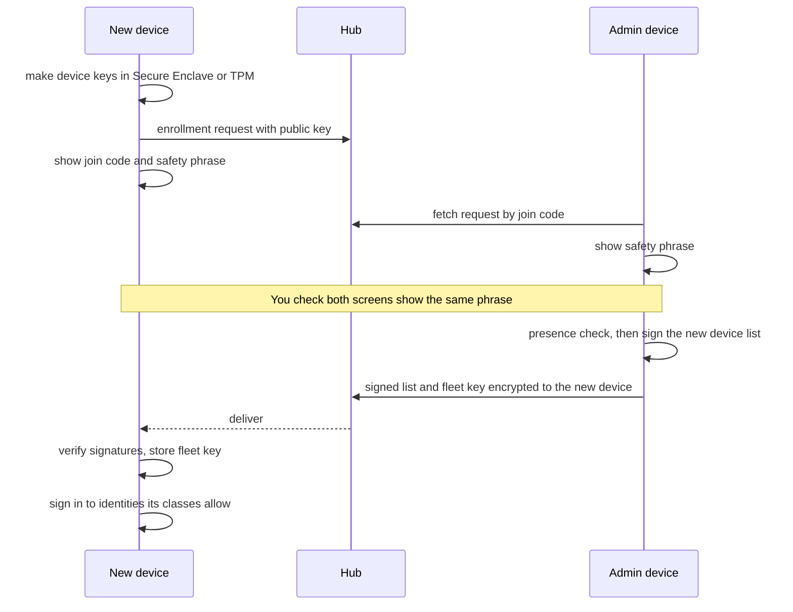

# How it works

**TL;DR:** You set rules once. Each tool asks Synapse through a door it already has. Synapse checks who is asking and where, picks the identity from the rules, and hands over that one credential for that one request. It writes the decision to a log and tells you when anything looks wrong.

## The policy: rules you write once

The policy is one TOML file. The app edits it for you, but it stays readable by hand. This example uses placeholders for employer names.

```toml
schema = 1

[fleet]
name = "sean"
default = "deny"                 # anything unmatched gets no credential

# Devices, and which classes of identity may live on each
[[devices]]
id = "work-mbp"
os = "macos"
classes = ["personal", "employer"]
role = "admin"

[[devices]]
id = "personal-mbp"
os = "macos"
classes = ["personal"]
role = "admin"

[[devices]]
id = "windows-pc"
os = "windows"
classes = ["personal"]
role = "member"

# Identities
[[identities]]
id = "gh-personal"
provider = "github"
account = "snds"                 # sign-in must match this login
class = "personal"
sign_in = ["github-app", "ssh-key"]
commit = { name = "Sean Sands", email = "<personal noreply address>" }

[[identities]]
id = "gh-employer"
provider = "github"
account = "<employer login>"
class = "employer"
sign_in = ["gh-import"]
commit = { name = "Sean Sands", email = "<employer noreply address>" }

[[identities]]
id = "linear-personal"
provider = "linear"
workspace = "<personal workspace>"
class = "personal"

[[identities]]
id = "jira-employer"
provider = "atlassian"
site = "<employer>.atlassian.net"
class = "employer"

# Routes: what uses which identity
[[routes]]
match = "github.com/snds/*"
use = "gh-personal"

[[routes]]
match = "github.com/<employer org>/*"
use = "gh-employer"

[[routes]]
service = "linear"
where = "repo:github.com/snds/*"     # inside personal repos, Linear means this account
use = "linear-personal"

[[routes]]
service = "jira"
where = "repo:github.com/<employer org>/*"
use = "jira-employer"

# Walls: never overridable, not even with `sy as`
[[walls]]
never = "personal identity in employer context"

[[walls]]
never = "employer identity on a device without the employer class"

# Account thresholds: per-identity limits and alert levels
[thresholds.default]
expiry_warning_days = 14
max_token_lifetime_days = 90
handouts_per_minute_alert = 30
refuse_scopes = ["delete_repo", "admin:org", "admin:enterprise"]

[thresholds."gh-employer"]
presence = "8h"                       # Touch ID or Hello, then good for 8 hours
surfaces = ["terminal", "claude-code", "cursor"]

[thresholds."jira-employer"]
mcp_writes = "ask"                    # agents must get your OK before writing
mcp_deny = ["delete_*"]
```

### How a request is matched

1. **Find the context.** The daemon gets the target (URL or service) and the working folder. It finds the repo that folder belongs to and lists **all** of that repo's remotes.
2. **Classify the repo.** If any remote matches an employer route, the whole repo is employer context. This stops an agent from adding a personal remote to an employer repo and pushing employer code out.
3. **Pick the rule.** The most specific match wins: exact repo, then owner, then host. Two equally specific rules are an error caught when you save, never at request time.
4. **Check the limits.** Is this identity's class allowed on this device? Is the calling surface allowed? Is a wall crossed? Is a presence check due? Is a threshold hit?
5. **Release or refuse.** A refusal returns one plain sentence to the tool and sends you a notification with a fix.

`sy explain <url or folder>` prints these steps. The app's **Rule tester** shows the same reasoning.

## Request flows

### git push over HTTPS



If GitHub rejects the token, git tells the helper to erase it. Synapse marks the identity unhealthy and notifies you: "Personal GitHub token was rejected. Reconnect?"

### `gh` commands

1. You or an agent runs `gh pr list` in a repo folder.
2. The `gh` shim finds the repo from `-R` or `--repo` if given, otherwise from the folder's remote.
3. The shim asks the daemon, which checks rules exactly as for git.
4. The shim runs the real `gh` with `GH_TOKEN` set in that process only. Your shell never sees the token.
5. Outside any repo, for example `gh api user`, the device's default identity applies. That default can't cross a wall.

### git over SSH

HTTPS is the default transport, because SSH to github.com is unreliable on some networks. SSH still works:

1. git runs `sy ssh` as its SSH command, and the arguments include the repo path.
2. The wrapper asks the daemon which identity owns that path.
3. It runs `ssh` with only that identity's key (`IdentitiesOnly`). That stops the agent from offering every key, which can sign you in as the wrong GitHub account.
4. Keys come from the device's SSH agent: the Bitwarden desktop agent for personal keys, and a device-local key for employer ones. A Synapse agent with one key per identity is a later option.

No host aliases such as `github-work` are needed, and remotes stay as plain GitHub URLs.

### An agent using Linear through the gateway



The agent app and the model never see the token. When a tool policy says "ask," the daemon shows a notification ("Claude Code wants to create an issue in Jira. Allow?") and waits.

### Other command-line tools

`sy run -- jira issue list` places secrets into the command's environment from references in a small per-project file or in the policy:

```toml
[run.jira]
env = { JIRA_API_TOKEN = "sy://jira-employer/token" }
```

This replaces 1Password's `op run` and shell plugins.

### One-off override

`sy as gh-personal -- gh repo create my-new-thing` uses a named identity once.

- It always needs a presence check.
- It is always logged.
- It can never cross a wall.

### A blocked cross-wall attempt

An agent in an employer repo is told, through a poisoned README, to run `git remote add backup https://github.com/snds/dump.git` and push.

1. The repo has an employer remote, so the whole repo is employer context.
2. The new remote routes to `gh-personal`, a personal identity. The wall refuses it.
3. The push fails, with this message: "Synapse refused: personal credentials can't be used from an employer repo."
4. You get a **critical** notification naming the repo, the remote and the app that ran it.
5. The employer identity isn't routed to `snds/*`, so it can't be used either. Both paths are closed.

## Signing in (adding an identity)

1. **Identities → Add.** Pick the provider and class. The app suggests a sign-in method based on the provider and class.
2. **Sign in:**
   - **Device flow:** the app shows a code and opens the provider page. You approve.
   - **Browser OAuth:** for MCP servers. The browser returns to a one-time local address.
   - **`gh` import:** the app runs `gh auth login` in a private throwaway config, takes the token, then cleans up.
   - **Paste:** for access tokens. The field sends the value straight to the daemon and clears itself.
3. **Identity pinning.** The daemon asks the provider "who is this?" and compares the answer with the identity's `account`. A mismatch is refused: "You signed in as snds, but this identity expects `<employer login>`." This catches the most common real mistake.
4. **Scope check.** Permissions broader than the identity's thresholds allow are refused or flagged.
5. **Store.** The token goes into this device's secure storage, under the identity's class key.

## Token lifecycle

- **Refresh:** short-lived tokens, such as GitHub App tokens that last 8 hours, refresh in the background before they expire.
- **Expiry warnings** start at the identity's threshold, 14 days by default.
- **Rejection:** a rejected token marks the identity unhealthy. You get one notification with one-click reconnect.
- **Rotation reminders** cover long-lived tokens (`gh` imports, access tokens, Linear API keys) at the identity's maximum lifetime.
- **Removal:** removing an identity deletes local copies and offers provider-side revocation.

## Health checks (Watch)

| Check | How | When | Level |
|---|---|---|---|
| Shared `gh` account flipped | Compare `gh`'s active account with the device default. Other tools still use it. | On file change and every 5 minutes | Warning |
| Token valid and correct account | Provider "who am I" call per identity | Hourly and on demand | Critical if invalid |
| Token expiring | Stored expiry against the threshold | Daily | Warning |
| Wrong commit identity | Author email of new commits in known repos against the routed identity | On new commits, at least every 30 minutes | Critical if personal in employer |
| git config drift | Helper, `useHttpPath`, includes and `sshCommand` still in place | On file change | Warning |
| Surface adapter drift | Each connected app's config still points at Synapse | On file change and daily | Warning |
| MCP upstream reachable | Connect and list tools per identity | Every 15 minutes | Warning |
| Vaultwarden | Reachable, version at or above the latest security release, certificate expiry. Backup age once the hub exists (Phase 4). | Every 6 hours | Warning, or critical if a security update is behind |
| Hub and sync | Reachable, policy version current | Hourly | Info, then warning after 3 days stale |
| Disk encryption | FileVault or BitLocker is on | Daily | Critical if off |
| Clock skew | Device time against network time (OAuth breaks when far off) | Daily | Warning |
| Audit chain | Hash chain intact | Daily | Critical |

## Notifications

- **Critical:** red icon, a notification that stays until handled, listed first. Examples: wall attempt blocked, token rejected, audit chain broken, disk encryption off.
- **Warning:** amber icon, one notification per issue. Examples: expiry approaching, adapter drift, Vaultwarden backup stale.
- **Info:** logged only. Examples: token refreshed, policy synced.

Each notification carries one action, such as "Reconnect," "Open rule," "Show details" or "Allow once." Repeats are merged until the state changes. Quiet hours and a daily summary are optional.

**Icon states:**

- **Green:** all good.
- **Amber:** warnings.
- **Red:** critical.
- **Grey:** locked.
- **Outline:** daemon not running.

## The app

| Screen | What you do there |
|---|---|
| Tray or menu-bar menu | Status line, issue count, **Lock now**, open the app |
| Overview | Health grouped by identities, surfaces, devices and server. Open issues, each with its fix. |
| Identities | Each account's provider, class, devices, token status ("expires in 12 days"), last use. Add, reconnect, remove. |
| Rules | Routes in plain words ("Repos owned by snds on GitHub → Personal GitHub"), walls and thresholds per account. **Rule tester:** paste a URL or pick a folder to see the identity and the reason. |
| Surfaces | Detected apps and their connection state: connect, disconnect, drift warnings. Hosted surfaces as a checklist with reminder dates. |
| Devices | Enrolled devices, last seen, classes. Enroll a new device. Remove a device with its revocation checklist. |
| Activity | The audit log, filtered by identity, tool or surface, with refusals highlighted |
| Settings | Lock behaviour, presence intervals, notifications, Vaultwarden and hub links, updates, recovery kit |

**By design, the app never shows a secret value and has no "copy token" button.** Copying tokens around is how most of them leak. Secrets go in by paste or sign-in and come out only to tools.

## The command line

```text
sy status                     health summary, same as the Overview screen
sy explain <url|folder>       which identity, and why
sy as <identity> -- <cmd>     one-off override (presence check, logged, can't cross walls)
sy run -- <cmd>               run with secret references resolved
sy lock                       lock all classes now
sy identity add|list|remove
sy surface list|connect|disconnect <name>
sy device enroll|list|remove
sy doctor                     self-check: config, PATH, git, adapters, storage
sy uninstall                  restore the git config, PATH and app configs saved at install
```

## When things fail

| Situation | What happens |
|---|---|
| Daemon not running | Tools fail closed: "Synapse isn't running. Start it from the menu bar." The OS restarts the daemon. |
| Locked after a restart | The request waits up to 30 seconds for Touch ID or Windows Hello, then fails |
| No rule matches | Refused. The notification offers "Add a rule for github.com/foo/*" with an identity picker. |
| Provider down | The tool shows the provider's error. Overview shows provider status. |
| Hub down | Nothing changes locally. Sync resumes later. |
| Vaultwarden down | Nothing changes for Synapse. Bitwarden apps keep their cached vault. |
| Policy fails to validate | The last good policy stays active. You get a notification naming the problem. |

## Device lifecycle

### First device (creating the fleet)

1. Install the app. Choose **Create a fleet**.
2. The device makes its keys in the Secure Enclave or TPM and becomes the first admin.
3. A **recovery kit** is created: a recovery key that can rebuild the fleet. It is saved to Vaultwarden as a secure note, and you print a copy.
4. Add identities, choose rule templates ("Personal GitHub," "Employer GitHub"), then connect detected surfaces.
5. Health check, then done.

### Adding a device



The new device gets rules, never tokens. It signs in to each identity itself, so every device holds its own token that can be revoked on its own. Without a hub, the same exchange happens by QR code or file.

### Removing or losing a device

1. On any admin device, open **Devices → Remove**, with a presence check.
2. A new fleet key and a new signed device list without that device go out. The removed device can't read anything new.
3. **Revocation checklist:** Synapse revokes what provider APIs allow and opens the right settings pages for the rest, tracking each item to done.
4. If the removed device comes back online, it receives a signed removal notice and wipes its local secrets. This is best effort. Revocation is the real protection.
5. If you lose the only admin device, the recovery kit restores admin rights.
